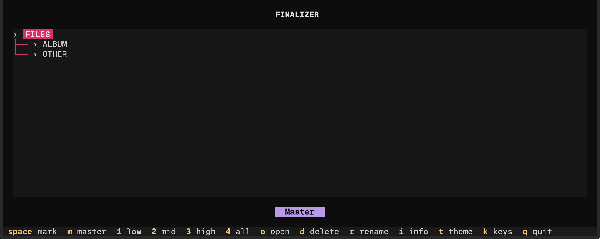
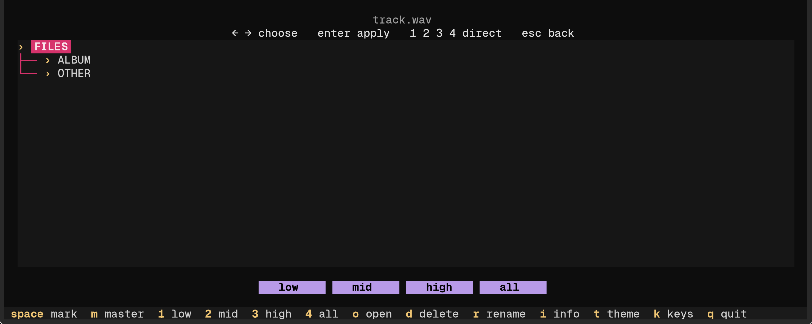

# FINALIZER

A final layer for drone material: not matching someone else's record, but fitting
an **admissible region** — a meta.

The meta is a design of perception, not a measurement of taste. It is derived
from what physically survives on playback devices — limiter headroom, cone
excursion, codec pre-echo — and checked against a catalogue.



The tree is always on screen and the button changes in place: `Master` →
`low / mid / high / all` → render → `Master` again, with the new file already
in the list.



## Installation

The quick way:

```bash
curl -fsSL https://raw.githubusercontent.com/369arc/finalizer/main/install.sh | sh
```

It checks python3 (3.11+) and ffmpeg, creates a private environment in
`~/.local/share/finalizer`, downloads the application and puts the `finalizer`
command into `~/.local/bin`. Nothing is installed system-wide: everything lives
in one directory, and `install.sh --uninstall` removes it.

```bash
finalizer            # the interface
finalizer run ...    # the CLI, e.g. finalizer run master SRC.wav --out OUT.wav
finalizer update     # fetch the latest main
finalizer path       # where it is installed
```

The script is plain POSIX shell — read it before piping if you prefer
(`curl -fsSL ... | less`), then run `sh install.sh` from the checkout.

### By hand

Python 3.11+ and **ffmpeg**. ffmpeg is not used for processing, only for input:
anything that is not 48 kHz / stereo / float is converted once
(`finalizer/ingest.py`). Without ffmpeg the program still runs, but opens only
48 kHz stereo PCM — the status line says so at startup.

```bash
# Arch
sudo pacman -S ffmpeg python-numpy python-scipy python-soundfile
pip install --user textual

# Debian / Ubuntu
sudo apt install ffmpeg python3-numpy python3-scipy python3-soundfile
pip install --user textual

# Fedora
sudo dnf install ffmpeg python3-numpy python3-scipy python3-soundfile
pip install --user textual

# macOS
brew install ffmpeg
pip install --user -r requirements.txt textual

# Windows (PowerShell)
winget install --id Gyan.FFmpeg
py -m pip install -r requirements.txt textual
```

`soundfile` ships a binary wheel on every platform; on Windows it needs the
common Visual C++ runtime, which is usually already installed.

Check that everything is in place:

```bash
python3 -c "import numpy, scipy, soundfile, textual; print('ok')"
ffmpeg -version | head -1
```

## Running

```bash
python3 tui.py                      # minimal interface
python3 run.py master SRC --out OUT # or straight through the CLI
```

Checks after installation:

```bash
python3 tests/test_engine.py   # every command, every profile, edge cases
python3 tests/test_tui.py      # 14 interface steps, no terminal needed
```

Both tests work only in temporary directories and never touch your files.

## The working point

```bash
python3 run.py master SRC.wav --out OUT.wav
```

All three profiles sit on the meta boundary: `crest 1.0`, `bass 1.0`
(< 240 Hz), `mid_guard 4.0` (240–4000 Hz). They differ only in density:
`low` / `mid` / `high` (see "Profiles"). The older, tighter `crest 0.8 /
bass 0.7` can still be requested on the command line. Without a profiles file
the render is neutral.

```
run.py meta                      # what the meta is and where the numbers come from
run.py check  FILE...            # how the material survives phone / laptop / car
run.py analyse FILE...           # contour, width, resonances, crest
run.py variants SRC --out-dir D  # a grid of parameters for close calls
```

## What the meta is

The meta is not a point, not a reference and not a target curve. It is a
**boundary**: a set of admissible numbers, inside which the sound is yours. It
answers one question — can this be released — and says nothing about anything
else.

Four groups, and only these.

**1. Crest ceiling per octave.** Phones, laptops and BT speakers have roughly
6 dB of headroom above the programme level before their own limiters start
working. A band whose crest is higher makes the device "breathe" — inaudible on
headphones, audible on a phone. Bass loses first: cone excursion is limited
before anything else. Above ~3 kHz a second limit appears — a lossy codec turns
high crest into pre-echo.

| band, Hz | ceiling | why |
|---|---|---|
| 30–1920 | 6.2 | device headroom, cone excursion |
| 1920–3840 | 7.2 | the codec starts to notice |
| 3840–7680 | 8.3 | pre-echo |
| 7680–15360 | 9.5 | |
| 15360–20000 | 10.3 | plenty of air, no real limit |

> **2026.1 calibration.** The default is now `drone-standard`: **7.7–15 kHz =
> 8.0 dB** (confirmed by two blind listening passes), **15–20 kHz = 10.3 dB**.
> The table above is the legacy `drone` boundary; `python3 run.py meta` prints
> the active one. `drone-safe` keeps 15–20 kHz at 5.0 dB for loud/dense
> playback; that upper-band cut is still awaiting a clean listening test.

**2. Crest floor.** 2.5 → 5 dB on the same bands. Below that it is no longer
mastering, it is squashing.

**3. Absolutes.** −14 LUFS (every streaming service normalises to it; anything
louder is turned down anyway) and −1 dBTP (measured true peak, not sample peak).

**4. Mono below 120 Hz.** The side channel is filtered out; the low end must
survive a single speaker.

**What the meta does not contain: a contour or a width profile.** Matching a
shape is a separate task and a separate flag (`--target`). One catalogue's
median as a norm would turn its habits into a law for everyone else, so those
fields simply do not exist here.

**Crest is a boundary, not a taste.** How close to sit to it is decided per
track: `--crest 0.85` sits 15% below the ceiling, `1.0` sits on it. A hard-coded
value would mean one track's taste became law for all; that is why it lives in
`profiles.toml`, not here.

**Two independent derivations agree.** Catalogue medians per octave: 6.0 / 5.0 /
7.0 / 6.6 / 6.7 / 6.4 / 7.4 / 8.9 / 11.3 / 9.1 dB. The device law: 6.2 up to
~2 kHz, then rising. They match — the catalogue already lives at the devices'
limit, and the meta merely formalises what the ear found on its own.

## Free contour — the main mode

Every track has its own frequency response; that is the artistic picture and it
must not be touched. So by default (`--meta drone`) the contour is **not fitted
at all**. Only what governs translation is regulated:

```
HPF → resonance suppression → width (mono low only)
    → per-band crest control → presence bell → loudness → limiter → trim
```

The key is that contour and crest are two **orthogonal statistics of the same
envelope**:

- band contour = `P75(E_b)` — the body, "where the band lives";
- band crest = `P99.5(E_b) − P75(E_b)` — the peak above the body.

Crest control cuts only the upper tail, above `P75 + meta`, so `P75` does not
change by construction. The report says exactly that: `contour preserved`.
On a static drone the body deviation is ≤ 1.5 dB RMS, LRA 3.56 → 3.66.

Shape fitting is switched on explicitly: `--fit-contour` (or `--target REF`,
where the reference is by definition the picture you asked for).

The order is chosen for cleanliness, not for effect:

- **contour EQ** (only with `--fit-contour`) — minimum-phase FIR. Linear phase
  gives pre-ringing: a click *before* the hit. For a drone that is poison.
- **resonances** are cut only where roughness exceeds the threshold; these are
  narrow peaks, not "brightness". The low end below 100 Hz is excluded — the
  edge of the spectrum is not a resonance.
- **width** is applied to the side channel with a minimum-phase FIR; below
  120 Hz the side is filtered out, so the low end is always mono.
- **crest control** is a static threshold `P75 of the band + meta`, not a
  tracking compressor: in a quiet section it does not invent a peak, in a loud
  one it does not pump.
- **the limiter** is a safety net, not a sound: 20 ms lookahead, 400 ms release,
  normally it never engages at all.
- **true peak** is measured at 4x and corrected with a static trim, so the
  ceiling is exact rather than approximate.

## The residual is the result

The tool does not pretend to converge. If a band hits `max_eq`, the report says
`LIMIT`; if the loudness is unreachable at the given ceiling, the difference is
shown. `feasible-band rms` is the contour error without the bands that are
physically unreachable.

The same with crest: cutting a peak "down to the sustain" (crest → 0) is a
square wave. Only the excess above `P75 + meta` is cut.

The `OVER` line is not a report but an assignment. The tool measures crest after
processing, subtracts the excess from that band's threshold and runs again until
every band is inside. This is valid because `clamp` is idempotent and `P75` does
not move under it: the body stays, only the tail is cut. The stopping criterion
is 0.1 dB.

## Profiles

The meta is the boundary, the profile is the pressure inside it. Taste lives in
`profiles.toml`, not in code and not in the meta:

```toml
default = "mid"

[low]        # no colouring: crest stage and limiter only
[mid]        # a 1 kHz bell, +4.5 dB, Q 0.4 -- a fixed shape
[high]       # a one-pass projection toward a speech curve -- shape from the track
```

```bash
python3 run.py master SRC --out OUT.wav
#   -> OUT_low.wav  OUT_mid.wav  OUT_high.wav  (every profile in the file)

python3 run.py master SRC --profile mid --out OUT.wav      # just one
python3 run.py master SRC --no-all-profiles --out OUT.wav  # only default
python3 run.py variants SRC --grid bass=0.5,0.7 --out-dir DIR
```

**`master` without `--profile` renders every profile in the file.** There are
three — `low`, `mid`, `high`. These are not three masterings but three pressures
inside one boundary. The ear decides on a given track; the tool ends with a
summary:

```
   profile  crest   kurt    LRA     TP  over  phone
       low  14.81   4.30   8.87  -3.11     0    5.2
       mid  15.17   4.37   8.78  -2.82     0    5.2
      high  15.98   4.49   9.76  -2.60     0    5.2
```

On dark material `high` lifts the air: on one dark drone piece +5.7 dB at 1 kHz
and **+13.2 dB at 10 kHz**. That is not a defect but a direct consequence of the track sitting
far below the speech curve up top. If the top is not wanted, take `mid`.

**`mid` versus `high`.** `mid` is a fixed bell: the same correction on any
material. `high` computes the correction **from the track itself**: it measures
the contour, subtracts the speech curve (LTASS) and applies the difference in one
pass (`--one-shot`), with a `max_eq` ceiling.

Single-pass is not an optimisation here but a condition: with iterations the loop
oscillates, and at full pull the result annihilates itself (on a bright, dense
piece +0.8 dB remained instead of +5.8).

Strength is governed by **`max_eq`, not `pull`**: the difference hits the ceiling
at both edges, the constant part is removed by normalisation, and what comes out
is the part that did not reach the ceiling. `max_eq 12` gives a +5.8 dB bell,
`max_eq 9` gives +3.3.

The numbers for `mid` came from `high`: the track was pulled, its response
measured, and the result reduced to a single filter — 0.44 dB rms across bands.

`crest` is peak/RMS of the whole wave, `kurt` is excess kurtosis, `over` is bands
above the meta, `phone` is the balance shift on a phone.

`--crest` scales the ceiling everywhere (control), `--bass` only below `bass_hz`
(the body). Earlier tests chose `crest 0.8 / bass 0.7`; the 2026.1 listening test
preferred the full boundary (`1.0 / 1.0`): more open, more space, more alive.
The default profiles now sit at the boundary. Any CLI flag overrides the
profile; an axis named in a `variants` grid replaces the profile value for that
axis only.

Important: this is a preference, not a law. The file is text and is edited for
the material — that is exactly how it should be used.

## Presence instead of saturation

For a long time it seemed that a track lacked density and that saturation was
the way to get it. What was audible turned out to be not distortion but a
**lift of the midrange**: harmonics of 300–600 Hz land exactly in 1–3 kHz, where
the ear reads body and presence. Saturation delivered that lift nonlinearly, so
it crackled, depended on the material and demanded a separate decision per track.

A bell does the same thing directly:

```toml
[mid]
eq_peak = [1000.0, 4.5, 0.4]   # +4.5 dB at 1 kHz, Q 0.4
```

One filter, linear, static. It generates no harmonics and does not touch the
meta boundary: a static equaliser changes a band's level, not its crest.

Important: the bell sits **after** the crest stage. Placed before it, it distorts
the crest measurement — in one run the 7.7–15 kHz band slipped out of control
because of it (12.4 against a ceiling of 9.5).

Everything that was saturation — `--sat*`, `--wave-drive`, `--peak-drive`,
`--crest-until`, the `mid`/`high`/`push` profiles — is gone. The numbers for the
bell were obtained by pulling a track 35% toward the speech curve (LTASS),
measuring the resulting response and reducing it to one filter — 0.42 dB rms
across bands from the original result.

## Translation check

`check` runs the material through device models (phone, laptop, BT speaker,
earbuds, car cabin, mono) and reports two things:

- **shift** — how far the balance moved where the device still reproduces;
- **lost** — how many bands that carried energy disappeared.

A phone always loses the sub — that is physics. If a phone also *changes* the
midrange, that is a mastering defect.

## Limitations

- **input is converted to 48 kHz / 2 channels / float32**. 16 and 24 bit are
  represented exactly in float32, so for them the conversion changes nothing;
  but 44.1 kHz with 48 kHz coefficients puts every crossover and every
  measurement 9% off. So anything that is not 48 kHz stereo is converted once
  by ffmpeg to `pcm_f32le` before it enters the chain (`finalizer/ingest.py`);
- **output depth is 24 bit** (`--bits 24|16|32f`). `sf.write` used to write
  PCM_16 silently — the WAV default in libsndfile. Noise floor: 16 bit −93 dBFS,
  24 bit −144 dBFS, so 24 bit is transparent while 16 bit leaves audible noise in
  quiet passages. 16 bit is written with TPDF dither: at that depth truncation is
  distortion, not noise;
- the contour is measured over the whole file: for compilations of dissimilar
  pieces the meta must be set per piece, not per album;
- device models are approximations (LR4 filters and shelves), not measurements of
  specific models;
- `master` holds the whole file in memory; hour-long pieces need ~2 GB.

## License

MIT — see `LICENSE`. It covers our code entirely.

**ffmpeg is neither shipped nor bundled.** It is called as an external program
(`ffmpeg` in `PATH`) and is needed only for input: anything that is not 48 kHz
stereo float is converted once. ffmpeg's own license (LGPL or GPL depending on
the build) belongs to your system, not to this repository — so MIT here mixes
with nothing.

`numpy`, `scipy`, `soundfile` and `textual` are likewise not shipped or bundled;
they are dependencies from `requirements.txt`, each under its own license.

### What the repository does not contain

- audio files or render results (`*.wav`, `out/`, `logs/`, `listen/`);
- test recordings or references taken from someone else's material;
- compiled binaries.

## Files

```
finalizer/meta.py      the meta numbers and their reasoning
finalizer/measure.py   contour, width, roughness, per-band crest
finalizer/devices.py   playback models and the translation metric
finalizer/chain.py     the chain and the outer iteration
finalizer/dsp.py       STFT, BS.1770, minimum-phase FIR, limiter
finalizer/ingest.py    input: any format -> 48 kHz / 2 ch / float32
run.py                 CLI
tui.py                 minimal interface (textual)
profiles.toml          taste: low / mid / high
references/            targets for --target-json
```
