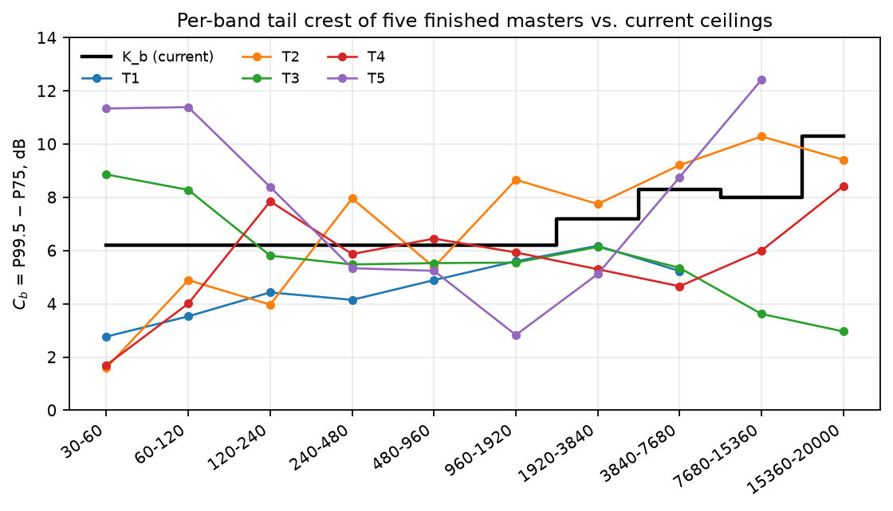
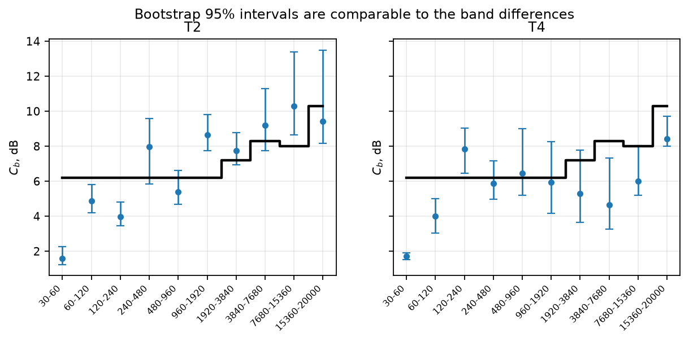
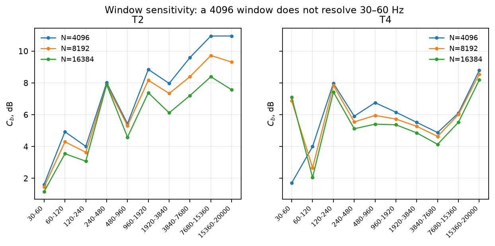
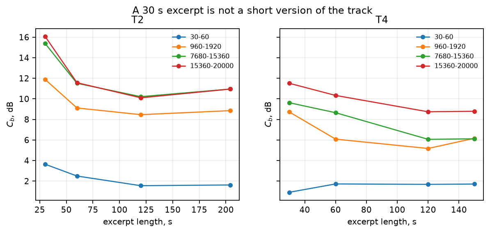
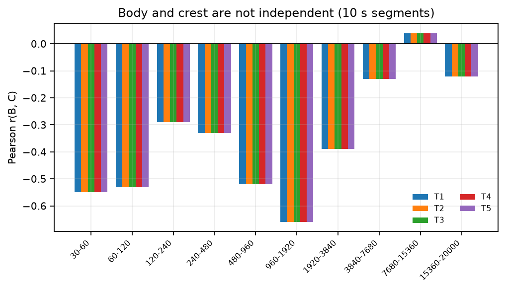
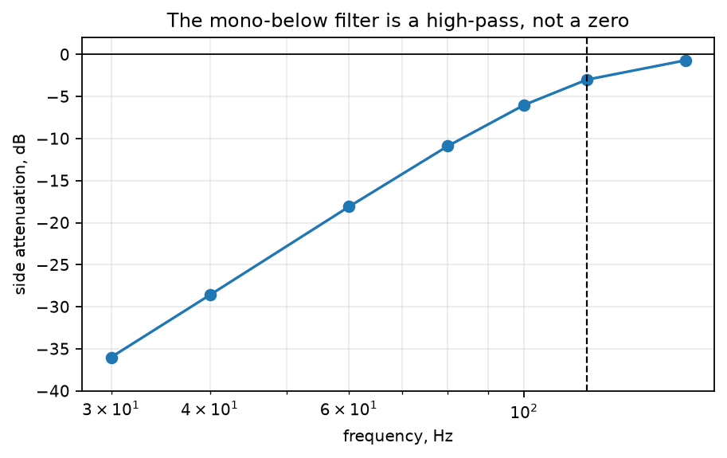

# Results

**Status:** measurements actually performed for the audit, with the current code at commit `af04531`. The device, codec-listening and floor experiments in `EXPERIMENT_DESIGN.md` have **not** been performed; they require a lab and listeners. This document reports what can be measured now, and marks the rest as `UNKNOWN`.

**Metric version used:** the current code's `band_crest` (4096/1024, max-based active gate, 45 dB no-programme gate), unless a section says otherwise. The proposed corrected metric is in `METRIC_SPECIFICATION.md`; the two are not interchangeable.

---

## 1. Environment

| item | value |
|---|---|
| date | 2026-11-06 |
| repository | `369arc/finalizer`, commit `af04531`, branch `main` |
| Python | 3.14.10 |
| numpy | 2.4.2 |
| scipy | 1.18.0 |
| soundfile | 0.14.0 |
| matplotlib | 3.11.2 |
| ffmpeg | 8.1.3 (native AAC, libopus) |
| sample rate | 48 000 Hz |
| analysis | `finalizer.dsp.stft`, periodic Hann, N=4096, hop=1024 (unless stated) |
| source material | five finished masters supplied by the author; not redistributed |

The measurements are read-only with respect to the source files. The scripts wrote only to a temporary directory. The full scripts are described in §10; they will be moved to `research/audit/` in Phase 5 so that the tables can be regenerated.

---

## 2. Corpus

Five finished stereo masters, 48 kHz, float32/24-bit:

| label | duration | use |
|---|---:|---|
| T1 | 152 s | corpus, estimator study |
| T2 | 204 s | corpus, estimator study, end-to-end master |
| T3 | 120 s | corpus, estimator study |
| T4 | 150 s | corpus, estimator study, end-to-end master, deharsh test |
| T5 | 110 s | corpus, estimator study, end-to-end master |

The corpus is a convenience sample: one author, sustained material, no claim of representativeness. It is used to test the estimator and the provenance of the current constants, not to estimate a population of all music.

The source files are not part of the repository. A reader without the files can reproduce the synthetic tests in §3.7 and the codec test in §4; the corpus tables require the author's files or a similar corpus.

---

## 3. Estimator study

### 3.1 The five masters against the current ceilings

`measure.band_crest` at 4096/1024, dB:

| band | K_b | T1 | T2 | T3 | T4 | T5 |
|---|---:|---:|---:|---:|---:|---:|
| 30–60 | 6.2 | 2.77 | 1.60 | **8.86** | 1.70 | **11.34** |
| 60–120 | 6.2 | 3.53 | 4.89 | **8.28** | 4.01 | **11.39** |
| 120–240 | 6.2 | 4.43 | 3.97 | 5.81 | **7.85** | **8.39** |
| 240–480 | 6.2 | 4.15 | **7.96** | 5.48 | 5.87 | 5.34 |
| 480–960 | 6.2 | 4.89 | 5.38 | 5.53 | **6.45** | 5.24 |
| 960–1920 | 6.2 | 5.60 | **8.66** | 5.55 | 5.93 | 2.83 |
| 1920–3840 | 7.2 | 6.18 | **7.75** | 6.14 | 5.30 | 5.12 |
| 3840–7680 | 8.3 | 5.23 | **9.21** | 5.35 | 4.66 | **8.76** |
| 7680–15360 | 8.0 | NaN | **10.29** | 3.62 | 6.00 | **12.42** |
| 15360–20000 | 10.3 | NaN | 9.41 | 2.96 | 8.43 | NaN |

**Bold** = above the ceiling. `NaN` = the current “no programme” gate did not assess the band. Fourteen of the 47 assessed band–track pairs are above the ceiling; three of the 50 are `NaN`.



The corpus is not centered on the ceiling. The medians of the five tracks are:

```
2.77 / 4.89 / 5.81 / 5.48 / 5.38 / 5.60 / 6.14 / 5.35 / 8.15 / 8.43 dB
```

The README's catalogue medians are:

```
6.0 / 5.0 / 7.0 / 6.6 / 6.7 / 6.4 / 7.4 / 8.9 / 11.3 / 9.1 dB
```

The differences are up to ~3.6 dB in the mid/high bands. The two sets are not the same curve; the README's “they match” claim is not reproduced on the available five masters.

### 3.2 Bootstrap uncertainty

Block bootstrap, 10 s blocks, 200 resamples, 95 % percentile interval. The full table:

| track | band | C_b | 95 % CI | sd | 10 s segment SD |
|---|---|---:|---|---:|---:|
| T1 | 30–60 | 2.78 | 0.64–6.01 | 1.44 | 1.85 |
| T1 | 60–120 | 3.53 | 2.13–4.45 | 0.65 | 0.94 |
| T1 | 120–240 | 4.45 | 3.57–5.30 | 0.45 | 0.54 |
| T1 | 240–480 | 4.19 | 3.25–5.31 | 0.51 | 0.62 |
| T1 | 480–960 | 4.94 | 2.91–5.81 | 0.71 | 1.45 |
| T1 | 960–1920 | 5.67 | 3.64–7.42 | 0.91 | 1.96 |
| T1 | 1920–3840 | 6.25 | 5.06–7.15 | 0.56 | 2.13 |
| T1 | 3840–7680 | 5.27 | 4.39–6.48 | 0.53 | 1.83 |
| T1 | 7680–15360 | 6.29 | 3.60–8.88 | 1.41 | 1.09 |
| T1 | 15360–20000 | 6.03 | 3.49–8.82 | 1.40 | 1.21 |
| T2 | 30–60 | 1.62 | 1.22–2.26 | 0.26 | 0.67 |
| T2 | 60–120 | 4.93 | 4.21–5.80 | 0.44 | 0.75 |
| T2 | 120–240 | 4.01 | 3.47–4.81 | 0.37 | 0.89 |
| T2 | 240–480 | 8.02 | 5.85–9.57 | 0.97 | 2.52 |
| T2 | 480–960 | 5.44 | 4.68–6.61 | 0.49 | 2.64 |
| T2 | 960–1920 | 8.85 | 7.75–9.81 | 0.54 | 2.81 |
| T2 | 1920–3840 | 7.97 | 6.93–8.77 | 0.47 | 2.87 |
| T2 | 3840–7680 | 9.60 | 7.74–11.28 | 0.95 | 3.37 |
| T2 | 7680–15360 | 10.95 | 8.66–13.39 | 1.20 | 4.31 |
| T2 | 15360–20000 | 10.95 | 8.15–13.50 | 1.44 | 5.94 |
| T3 | 30–60 | 9.10 | 4.34–10.74 | 1.47 | 2.42 |
| T3 | 60–120 | 8.40 | 5.34–9.55 | 1.03 | 2.53 |
| T3 | 120–240 | 5.87 | 4.65–7.10 | 0.68 | 1.15 |
| T3 | 240–480 | 5.53 | 4.42–6.92 | 0.65 | 1.40 |
| T3 | 480–960 | 5.59 | 4.30–7.86 | 0.95 | 0.81 |
| T3 | 960–1920 | 5.60 | 4.54–6.75 | 0.59 | 1.52 |
| T3 | 1920–3840 | 6.13 | 4.87–6.98 | 0.52 | 1.17 |
| T3 | 3840–7680 | 5.43 | 2.73–6.81 | 1.23 | 0.85 |
| T3 | 7680–15360 | 3.64 | 2.92–4.33 | 0.36 | 0.84 |
| T3 | 15360–20000 | 2.98 | 2.32–4.61 | 0.54 | 0.66 |
| T4 | 30–60 | 1.71 | 1.53–1.92 | 0.09 | 0.66 |
| T4 | 60–120 | 4.00 | 3.03–5.00 | 0.49 | 1.46 |
| T4 | 120–240 | 7.98 | 6.45–9.03 | 0.74 | 1.64 |
| T4 | 240–480 | 5.91 | 4.98–7.16 | 0.56 | 2.35 |
| T4 | 480–960 | 6.76 | 5.20–8.99 | 0.93 | 1.75 |
| T4 | 960–1920 | 6.16 | 4.17–8.25 | 1.04 | 1.80 |
| T4 | 1920–3840 | 5.52 | 3.65–7.78 | 1.16 | 1.83 |
| T4 | 3840–7680 | 4.88 | 3.26–7.31 | 1.01 | 3.25 |
| T4 | 7680–15360 | 6.11 | 5.21–8.02 | 0.63 | 5.24 |
| T4 | 15360–20000 | 8.79 | 8.01–9.71 | 0.50 | 13.16 |
| T5 | 30–60 | 12.38 | 10.35–14.23 | 1.02 | 2.47 |
| T5 | 60–120 | 11.75 | 8.87–12.98 | 1.15 | 2.49 |
| T5 | 120–240 | 8.64 | 7.32–10.10 | 0.73 | 2.08 |
| T5 | 240–480 | 5.63 | 4.35–6.96 | 0.71 | 2.13 |
| T5 | 480–960 | 5.42 | 4.67–6.02 | 0.41 | 1.50 |
| T5 | 960–1920 | 2.91 | 2.44–3.75 | 0.33 | 2.67 |
| T5 | 1920–3840 | 5.34 | 4.20–6.21 | 0.48 | 3.05 |
| T5 | 3840–7680 | 9.09 | 6.97–10.71 | 1.04 | 2.88 |
| T5 | 7680–15360 | 12.66 | 10.64–14.29 | 0.84 | 3.97 |
| T5 | 15360–20000 | 9.04 | 5.68–11.08 | 1.46 | 2.61 |



The intervals are often 2–4 dB wide; the band-to-band differences in `K_b` are 0.3–2.3 dB. The current curve is more resolved than the estimator. The segment-to-segment SD is larger than the bootstrap SD, which means the material is non-stationary; the “tail crest” is not a single stable property of the track.

### 3.3 Window sensitivity

`C_b` at N=4096/8192/16384, hop=N/4, for the lowest two bands and the top two:

| track | band | 4096 | 8192 | 16384 | max change |
|---|---|---:|---:|---:|---:|
| T1 | 30–60 | 2.78 | 2.79 | 2.56 | 0.23 |
| T2 | 30–60 | 1.62 | 1.47 | 1.17 | 0.45 |
| T3 | 30–60 | 9.10 | 9.05 | 9.18 | 0.13 |
| T4 | 30–60 | 1.71 | 6.87 | 7.10 | **5.39** |
| T5 | 30–60 | 12.38 | 11.37 | 10.09 | 2.29 |
| T1 | 60–120 | 3.53 | 3.38 | 2.93 | 0.60 |
| T2 | 60–120 | 4.93 | 4.30 | 3.55 | 1.38 |
| T3 | 60–120 | 8.40 | 8.52 | 8.72 | 0.32 |
| T4 | 60–120 | 4.00 | 2.66 | 2.05 | **1.95** |
| T5 | 60–120 | 11.75 | 11.05 | 10.77 | 0.98 |
| T1 | 7680–15360 | 6.29 | 6.01 | 6.17 | 0.28 |
| T2 | 7680–15360 | 10.95 | 9.73 | 8.39 | **2.56** |
| T3 | 7680–15360 | 3.64 | 3.49 | 3.36 | 0.28 |
| T4 | 7680–15360 | 6.11 | 6.02 | 5.53 | 0.58 |
| T5 | 7680–15360 | 12.66 | 12.33 | 11.98 | 0.68 |
| T1 | 15360–20000 | 6.03 | 5.97 | 6.03 | 0.06 |
| T2 | 15360–20000 | 10.95 | 9.31 | 7.57 | **3.38** |
| T3 | 15360–20000 | 2.98 | 2.93 | 3.02 | 0.09 |
| T4 | 15360–20000 | 8.79 | 8.56 | 8.19 | 0.60 |
| T5 | 15360–20000 | 9.04 | 8.93 | 8.73 | 0.31 |



The lowest band is not window-invariant. `T4` moves by 5.4 dB; the 30–60 band has three bins at 4096. The top bands move by up to 3.4 dB because a longer window smears transients. A single 4096 window is a compromise that is not adequate at either end.

### 3.4 Duration sensitivity

`C_b` at the first 30/60/120 s and the full track, for selected bands:

| track | band | 30 s | 60 s | 120 s | full | max change |
|---|---|---:|---:|---:|---:|---:|
| T1 | 30–60 | 0.38 | 0.69 | 3.72 | 2.78 | 3.34 |
| T1 | 7680–15360 | 7.22 | 4.16 | 5.65 | 6.29 | 3.06 |
| T2 | 960–1920 | 11.89 | 9.11 | 8.46 | 8.85 | 3.43 |
| T2 | 7680–15360 | 15.39 | 11.51 | 10.21 | 10.95 | 5.18 |
| T2 | 15360–20000 | 16.08 | 11.57 | 10.10 | 10.95 | **5.98** |
| T3 | 30–60 | 11.77 | 9.28 | 9.10 | 9.10 | 2.67 |
| T4 | 120–240 | 4.96 | 5.97 | 7.57 | 7.98 | 3.02 |
| T4 | 15360–20000 | 11.51 | 10.33 | 8.74 | 8.79 | 2.77 |
| T5 | 7680–15360 | 3.93 | 13.00 | 12.66 | 12.66 | **9.07** |
| T5 | 15360–20000 | 4.50 | 7.01 | 9.04 | 9.04 | 4.54 |



A 30 s excerpt is not a short version of the track. The tail statistic is dominated by where the loud section falls. A 60 s minimum is necessary, not sufficient; the CI is the real statement.

### 3.5 Body–crest dependence

Across 10 s segments of the five tracks:

| band | Pearson r(B, C) |
|---|---:|
| 30–60 | −0.55 |
| 60–120 | −0.53 |
| 120–240 | −0.29 |
| 240–480 | −0.33 |
| 480–960 | −0.52 |
| 960–1920 | −0.66 |
| 1920–3840 | −0.39 |
| 3840–7680 | −0.13 |
| 7680–15360 | +0.04 |
| 15360–20000 | −0.12 |
| **pooled** | **−0.36** |



The negative correlation is systematic: a louder body is associated with a smaller relative tail; a quieter body with a larger relative tail. B and C are not independent. The claim “orthogonal by construction” is rejected.

### 3.6 Gain invariance

`x` and `2x` (`+6.0206 dB`) on the five tracks:

```
max |B_b(2x) − B_b(x) − 6.0| = 0.0206 dB   (the 0.0206 is 20 log10(2), the exact gain)
max |B_b(2x) − B_b(x) − 6.0206| = 0.0000 dB
max |C_b(2x) − C_b(x)| = 0.000000 dB
```

Gain invariance is verified exactly (up to floating-point precision). This is the only sense in which B and C are “orthogonal”: a constant gain moves the body and leaves the crest unchanged.

### 3.7 Synthetic short-event test

A 30 s track with a quiet 7680–15360 body (−30 dB relative to the bass) and a burst at +50 dB relative to that body; the burst duration is varied:

| burst | raw `P99.5 − P75` | `measure.band_crest` | `len(act)` |
|---:|---:|---:|---:|
| 0.10 s | 29.8 dB | **NaN** | 8 |
| 0.25 s | 49.7 dB | **NaN** | 15 |
| 0.30 s | 49.8 dB | **NaN** | 17 |
| 0.50 s | 49.9 dB | **0.38 dB** | 27 |

The current estimator can report a 50 dB event as 0.38 dB (inside the 8.0 dB ceiling) or as `NaN` (treated as a pass). The raw `P99.5 − P75` sees the event; the max-based active gate excludes the body and then measures the event against itself.

A single full-scale click of 1–2 samples changed the measured C by < 0.15 dB on the five tracks. The failure is not a single click; it is a *sustained short event* in a quiet band, exactly the codec/limiter case.

### 3.8 Crest-stage body change

`T2` first 30 s, one `chain.crest_stage` call with a 6.2 dB ceiling:

| band | B before | B after | ΔB | C before | C after |
|---|---:|---:|---:|---:|---:|
| 30–60 | 51.08 | 51.08 | 0.00 | 3.64 | 3.64 |
| 60–120 | 37.53 | 37.53 | 0.00 | 6.15 | 5.88 |
| 120–240 | 37.89 | 37.88 | 0.00 | 6.25 | 6.02 |
| 240–480 | 33.35 | 33.32 | −0.03 | 8.34 | 6.31 |
| 480–960 | 25.59 | 25.56 | −0.03 | 7.91 | 6.36 |
| 960–1920 | 23.65 | 23.47 | −0.19 | 11.89 | 7.03 |
| 1920–3840 | 24.43 | 24.10 | −0.33 | 11.50 | 7.49 |
| 3840–7680 | 22.81 | 22.22 | −0.60 | 13.67 | 7.88 |
| 7680–15360 | 22.24 | 20.22 | **−2.02** | 15.39 | 9.67 |
| 15360–20000 | 20.43 | 18.35 | **−2.09** | 16.08 | 9.74 |

The body is not untouched by construction. For large cuts it moves by ~2 dB in the top bands. The full-track tests moved less (< 0.6 dB in the high bands), but the claim is material-dependent, not a theorem.

---

## 4. Codec pre-echo experiment

`research/pre_echo.py` (current version) generated “body → 100 ms quiet gap → 50 ms burst” in four bands, encoded with AAC 128/96/64/48/32 kbps and Opus 96 kbps, decoded, aligned by envelope correlation, and measured the codec-added residue in the 20 ms before the burst. The body is at −30 dB, the gap at −60 dB; the burst is at the nominal crest above the body. The script uses a 128-sample RMS envelope and an 8th-order Butterworth band-pass.

Current output (added residue, dB; positive = the codec added energy):

| band | codec | 3 | 6 | 9 | 12 | 15 | 18 | 21 | at 21 dB re body |
|---|---|---:|---:|---:|---:|---:|---:|---:|---:|
| 1920–3840 | AAC 128 | 0.0 | 0.0 | 0.0 | 0.0 | 0.0 | 0.0 | 0.0 | −30.3 |
| 1920–3840 | AAC 96 | 0.1 | 0.1 | −0.3 | −0.3 | 0.1 | 0.1 | 0.4 | −30.0 |
| 1920–3840 | Opus 96 | 0.3 | 0.5 | 0.7 | 0.1 | 0.3 | 0.4 | 0.5 | −29.8 |
| 3840–7680 | AAC 128 | 0.7 | 0.8 | 1.0 | 1.9 | 2.2 | 2.1 | 2.5 | −28.1 |
| 3840–7680 | AAC 96 | 0.5 | 0.9 | 1.0 | 1.6 | 1.8 | 2.3 | 1.9 | −28.7 |
| 3840–7680 | Opus 96 | −0.2 | −0.1 | −0.1 | 0.0 | −0.4 | −0.1 | 0.1 | −30.5 |
| 7680–15360 | AAC 128 | −0.1 | 0.6 | −0.1 | −0.1 | −0.1 | −0.1 | −0.1 | −30.6 |
| 7680–15360 | AAC 96 | −0.3 | −0.1 | −0.3 | −0.2 | 0.0 | −0.1 | 0.0 | −30.6 |
| 7680–15360 | Opus 96 | 0.0 | 0.1 | 0.2 | 0.2 | 0.5 | 0.9 | 1.1 | −29.4 |
| 15360–20000 | AAC 128 | −3.4 | −3.4 | −3.4 | −2.4 | −2.2 | −3.0 | −2.8 | −32.5 |
| 15360–20000 | AAC 96 | −6.1 | −6.1 | −6.1 | −6.1 | −5.7 | −5.7 | −8.0 | −37.7 |
| 15360–20000 | Opus 96 | 0.1 | 0.1 | 0.2 | 0.2 | 0.4 | 0.8 | 1.0 | −28.7 |

The codec-added residue is at most `+2.5 dB` (AAC 128, 3840–7680) and remains `28–38 dB` below the body. With a competing 0 dBFS bed, the added residue rose to at most `+3.5 dB`, still `27 dB` below the body. At 48 and 32 kbps the band was dropped rather than smeared (added residue `−23` to `−135 dB`).

**Interpretation.** In the tested conditions, the codec does not bind: the residue stays far below the body for crests up to 21 dB. This removes the codec as the *justification* for the top-band ceilings. It does not establish the ceilings, and it does not generalize to other codecs, bitrates, encoders, stereo material or real music. The test is synthetic mono band noise, one encoder implementation, 50 ms bursts, one gap length; there are no confidence intervals and no listening test.

**Measurement caveats.** The body occupies 75 % of each 600 ms period, so P75 sits at the body/gap boundary; the `band_crest` of the test signal is 0.4–0.7 dB below the nominal label (e.g., 2.6 at nominal 3, 5.4 at 6, 11.4 at 12, 20.3 at 21). The gap window is ~20 ms, matching a codec window; the 8th-order band-pass has a group delay but no pre-ringing. The residue is averaged in dB, not power, which biases it downward by ~1–2 dB for a fluctuating residue. The `pre_echo.py` docstring's claim that “a residue 30 dB below the body is inaudible in any realistic playback” is not supported by a listening test and should be removed.

---

## 5. Loudness and true peak

### 5.1 Integrated loudness

`dsp.lufs_integrated` vs `ffmpeg ebur128`:

| signal | code | ffmpeg | difference |
|---|---:|---:|---:|
| 1 kHz sine, −3 dBFS | −2.993 | −3.0 | +0.007 |
| T2 full | −11.038 | −11.0 | −0.038 |
| T4 full | −17.513 | −17.5 | −0.013 |
| T2 low master | −13.94 | −13.9 | −0.04 |
| T4 low master | −14.00 | −14.0 | 0.00 |

The implementation is conformant within 0.05 dB on these signals. It uses the BS.1770-4 K-weighting, 400 ms blocks, 75 % overlap, absolute gate −70 LUFS, relative gate −10 LU. The function accepts an `sr` argument but ignores it; the coefficients are 48 kHz only.

### 5.2 True peak

`dsp.true_peak` vs `ffmpeg`:

| signal | code TP | ffmpeg TP | difference |
|---|---:|---:|---:|
| 1 kHz sine, −3 dBFS | −2.994 | −3.000 | +0.006 |
| 19 kHz sine, 0 dBFS | 0.277 | 0.800 | −0.523 |
| 12 kHz sine, 0 dBFS | 0.006 | 0.500 | −0.494 |
| fs/4 sine, 45° | 0.115 | 0.600 | −0.485 |
| T2 full | 0.794 | 0.800 | −0.006 |
| T4 full | −4.172 | −4.200 | +0.028 |
| T2 low master | −1.000 | −1.000 | 0.000 |
| T4 low master | −1.000 | −1.000 | 0.000 |

On real programme the agreement is excellent; on high-frequency sines the code under-reads by ~0.5 dB. The code uses `scipy.signal.resample_poly(..., 4, 1)`, not the 48-tap/4-phase filter of BS.1770-4 Annex 2. The `−1 dBTP` target is a platform convention; the meter must be named.

---

## 6. Stereo and mono

### 6.1 The mono filter

`chain.stereo_width(mono_below=120)` on a pure side tone:

| frequency | attenuation |
|---:|---:|
| 30 Hz | −36.0 dB |
| 40 Hz | −28.6 dB |
| 60 Hz | −18.1 dB |
| 80 Hz | −10.9 dB |
| 100 Hz | −6.0 dB |
| 120 Hz | −3.0 dB |
| 160 Hz | −0.7 dB |



The filter is a 3rd-order Butterworth; the side is not zero below 120 Hz.

### 6.2 On the masters

| track | side/mid, 20–120 Hz, source | side/mid, output | corr<100 source → output |
|---|---:|---:|---:|
| T2 | −17.4 dB | −28.0 dB | 0.98 → 1.00 |
| T4 | −2.7 dB | −15.3 dB | 0.38 → 0.91 |

The output is much more mono-compatible, but it is not mono. `T4` had an almost fully stereo bass (side/mid −2.7 dB); the filter reduced it by 12.6 dB, still above the residual of `T2`.

---

## 7. End-to-end master tests

The `low` profile, meta mode, `--no-deharsh` unless stated; 24-bit output.

### 7.1 T2, full 204 s

| band | before | after | ceiling |
|---|---:|---:|---:|
| 30–60 | 1.60 | 1.7 | 6.2 |
| 60–120 | 4.89 | 5.1 | 6.2 |
| 120–240 | 3.97 | 4.1 | 6.2 |
| 240–480 | 7.96 | 5.8 | 6.2 |
| 480–960 | 5.38 | 5.3 | 6.2 |
| 960–1920 | 8.66 | 5.8 | 6.2 |
| 1920–3840 | 7.75 | 7.0 | 7.2 |
| 3840–7680 | 9.21 | 8.1 | 8.3 |
| 7680–15360 | 10.29 | 7.5 | 8.0 |
| 15360–20000 | 9.41 | 8.8 | 10.3 |

`crest: 0 band(s) still over`; `LUFS −13.94`; `TP −1.00`; contour `max |d| 1.38 dB, rms 0.46 dB`. The T2 run used the default `deharsh`; it applied one notch at `159 Hz` (`−1.1 dB`). The `--no-deharsh` variants are in §7.2 and §7.3.

### 7.2 T4, full 150 s

With default `deharsh`:

```
removed: 126Hz −3.2, 504Hz −3.8, 1008Hz −4.0, 1600Hz −1.5
contour preserved: max |d| 3.93 dB, rms 3.18 dB
crest: 0 band(s) still over
LUFS −14.00, TP −1.00
```

With `--no-deharsh`:

```
contour preserved: max |d| 3.43 dB, rms 0.86 dB
crest: 0 band(s) still over
LUFS −14.00, TP −1.00
```

The `−4.0 dB` notch at 1008 Hz is at the 1 kHz reference. Because the contour is reported relative to 1 kHz, the notch makes every other band look ~4 dB higher; the “contour preserved” number is dominated by the notch, not by the crest stage.

### 7.3 T5, full 110 s, `--no-deharsh`

| band | before | after | ceiling |
|---|---:|---:|---:|
| 30–60 | 11.34 | 6.1 | 6.2 |
| 60–120 | 11.39 | 5.7 | 6.2 |
| 120–240 | 8.39 | 5.7 | 6.2 |
| 240–480 | 5.34 | 5.2 | 6.2 |
| 480–960 | 5.24 | 5.1 | 6.2 |
| 960–1920 | 2.83 | 2.8 | 6.2 |
| 1920–3840 | 5.12 | 5.1 | 7.2 |
| 3840–7680 | 8.76 | 7.9 | 8.3 |
| 7680–15360 | 12.42 | 7.3 | 8.0 |
| 15360–20000 | NaN | NaN | 10.3 |

`crest: 0 band(s) still over`; `LUFS −14.00`; `TP −3.58`; contour `max |d| 2.00 dB, rms 0.64 dB`. The top octave is not assessed; the report says “no programme in source”.

### 7.4 The synthetic 50 dB burst

The chain did cut the burst on the synthetic test: source raw `C = 49.95 dB`, output raw `C = 0.15 dB`; the applied target for the affected bands was driven to `0.0`. The output is clean, but the *meter* would have reported the source as `0.22 dB`/`NaN`; the chain and the meter disagree. This is a validation defect, not a demonstration that the chain is safe.

---

## 8. What the results support

- **Gain invariance** of B and C: VERIFIED.
- **Loudness** implementation vs BS.1770-4/ffmpeg: SUPPORTED within 0.05 dB on the tested signals.
- **True peak** on real programme: SUPPORTED within 0.03 dB; **not** standard-conformant on worst-case HF signals.
- **Codec pre-echo not binding** at AAC 96/128 and Opus 96 in the synthetic test: SUPPORTED for the tested conditions; not general.
- **The current C_b is a tail statistic**, not a peak: VERIFIED by the synthetic burst test and the duration sensitivity.
- **The current gate can hide a 50 dB event**: VERIFIED.
- **B and C are dependent**: VERIFIED (negative correlation).
- **A deep crest cut can move the body**: VERIFIED on the 30 s excerpt; the full-track effect is smaller.
- **The floor is not implemented**: VERIFIED by code search.
- **The side rule is a high-pass**: VERIFIED by measurement.
- **The corpus does not reproduce the README catalogue medians**: VERIFIED on the five available masters.

## 9. What the results do not support

- A measured `K_b` for any device, band or SPL.
- A measured `F_b`.
- A general codec law.
- A perceptual audibility threshold.
- A claim that the current `K_b` values are correct.
- A claim that the current `K_b` values are wrong. They are unmeasured; the audit does not replace them with another guess.

## 10. Reproducibility

The core measurement is:

```python
X = dsp.stft(x, 4096, 1024)            # (frames, bins, 2), periodic Hann
P = dsp.band_power(X)                  # sum of channel powers
f = np.fft.rfftfreq(4096, 1 / 48000)
E = np.empty((P.shape[0], len(edges) - 1))
for b in range(len(edges) - 1):
    sel = (f >= edges[b]) & (f < edges[b + 1])
    E[:, b] = 10 * np.log10(P[:, sel].sum(axis=1) + 1e-20)
```

The current `band_crest` then applies the max-based active gate and the `top − 45 dB` no-programme gate; the audit uses the same function for Table 3.1. The bootstrap resamples 10 s blocks of frames (469 frames per block at a 1024 hop), 200 times. The window sensitivity recomputes the envelope at N=8192/2048 and N=16384/4096. The duration sensitivity truncates the signal before the STFT. The crest-stage test calls `chain.crest_stage` with the 6.2 dB ceiling.

The scripts that produced the tables are in `/tmp/opencode/audit_crest.py` and `/tmp/opencode/audit_relations.py` for this session; they will be committed under `research/audit/` in Phase 5, with a JSON output and the environment recorded. The figures are generated by `/tmp/opencode/make_figures.py` and stored in `research/figures/`.

## 11. Limitations

1. **Five tracks, one author.** Not a representative corpus; the medians and correlations are descriptive, not population estimates.
2. **No device measurements.** The `devices.py` models are synthetic; the audit did not measure a real phone, laptop, BT speaker, earbud, car or monitor.
3. **No listening test.** The codec result and the crest values have no perceptual threshold. “Audible” is not measured.
4. **One codec encoder implementation.** `ffmpeg` native AAC and `libopus`; other encoders may differ.
5. **Synthetic codec stimulus.** Mono band noise, 50 ms bursts, one gap length; real music and stereo masking are not tested.
6. **The current estimator is the object under test.** The bootstrap and window/duration tables use the current `band_crest`; changing the estimator changes the numbers. The proposed multi-resolution estimator is not yet implemented.
7. **The master tests use the code's own meters.** LUFS/TP were cross-checked with ffmpeg; the crest values were not independently measured by a second implementation.
8. **The source files are not redistributed.** The corpus tables cannot be reproduced without the author's files; the synthetic and codec tests can.

## 12. Conclusion

The measurements do not confirm the current meta. They confirm the mathematical behaviour of the estimator (gain invariance, dependence, tail-vs-peak) and the conformance of the loudness meter; they expose a serious gate/`NaN` defect in the crest estimator, a false `side = 0` claim, an unimplemented floor, a non-neutral `low` profile, and a catalogue/ear provenance that the five masters do not reproduce. The codec result removes one justification for the top-band ceilings without replacing it. The device, codec-listening and floor experiments are still required before any `K_b` or `F_b` can be called measured.
