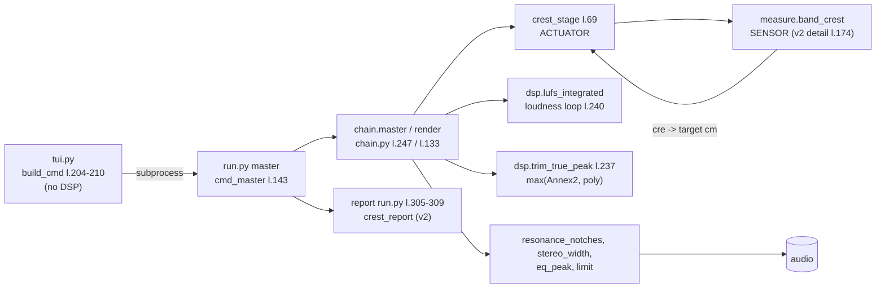

# v1 vs v2: a technical comparison of the sensor and the mastering chain

**Date:** 2026-11-06
**v1:** `af04531` — the pre-audit state (materialised with `git archive`; no worktree is kept in the repository).
**v2:** `90d1a64` (HEAD `main`; the tree was clean at measurement time). The production fix is `d9fc249`; `228b1ef`, `312c1ea` and `90d1a64` changed documentation only.
**Data:** `research/audit/compare_v1_v2.json`. References such as `json:bursts` point to a key in that file. Script: `research/audit/compare_v1_v2.py`.
**What was done:** measurement only. No audio was written to the repository; renders live in `<work>/renders/`.
**Corpus labels:** `T1`–`T5` are anonymised corpus items. The mapping to source files is not stored in the repository.

Statuses: **VERIFIED** (reproduced by measurement or by reading the code, with the location given), **SUPPORTED** (consistent with the data, not exhaustively tested), **HYPOTHESIS**, **ASSUMPTION**, **UNKNOWN**, **REJECTED**.
Model-derived quantities are marked “model”. There are no listening data in this report, and no conclusion rests on any.

---

## 1. Executive technical summary

1. **The meta numbers did not change.** `CREST_MAX`, `CREST_MIN`, `LUFS`, `TP`, `MONO_BELOW` and `CREST_EDGES` are identical in v1 and v2; verified by importing both trees (`json:identity.constants`). v2 removed `CREST_MAX_CALIBRATED`, a byte-for-byte duplicate of `CREST_MAX`, and added the `metric_version` string. **VERIFIED.**

2. **The sensor and the decision rule changed.** Five functions changed logic: `measure.band_crest` (sensor), `chain.crest_stage` (control actuator), `chain.render` (clamp of the target to the floor), `dsp.true_peak` (maximum of two meters), and `dsp.lufs_integrated` (sample-rate guard only). `stereo_width`, `resonance_notches`, `features`, `sustain_contour`, `stft`, `band_power`, `limit` and `trim_true_peak` did not change (`json:identity.fingerprints`). **VERIFIED.**

3. **Corpus decisions (5 tracks, 50 band×track pairs).** 45 pairs kept their meaning: 32 `ok→PASS`, 13 `over→FAIL`. Five pairs changed meaning (`json:corpus.transitions_v1_to_v2`):
   - three pairs were not assessed (`NaN`, which v1 treated as ok) and became PASS: T1 7.7–15 kHz (6.23 at K 8.0), T1 15–20 kHz (5.92 at K 10.3), T5 15–20 kHz (8.71 at K 10.3);
   - two pairs became FAIL: T2 15–20 kHz (9.41 → 10.77 at K 10.3), T4 480–960 Hz (6.45 → 6.66; FAIL threshold 6.55). **VERIFIED.**

4. **The main difference on ordinary material is the population, not event detection.** v1 computes the body (P75) only over frames where the band is above its own maximum minus 45 dB, and therefore discards the quietest frames of the band. The body moves up and the crest is underestimated. On T2 15–20 kHz the v1 body is 34.67 dB and the v2 body is 33.27 dB; the 1.40 dB body difference matches the 1.36 dB crest difference (`json:corpus.tracks.T2`). **VERIFIED.**

5. **v1 missed events, including events at the output.** A synthetic +50 dB burst lasting 0.5 s in a 30-second file: v1 gives 0.22 dB, v2 gives 49.95 dB (`json:bursts`). For 0.1 s and 0.25 s v1 returns `NaN`; in `check` and `master`, `NaN` was treated as `ok`. In one crest-stage pass, v1 measured a raw crest of 71 dB in 960–1920 Hz while its own report said “ok (not assessed)” (`json:control`). **VERIFIED.**

6. **v2 closes this class only partially.** `C_tail` sees an event only if it occupies a noticeable fraction of the active frames (≈0.5 %). In a 120-second file a 0.5 s burst gives `C = 0.67 dB` with status OK — a false PASS. A 0.1 s burst in a 60-second file is also invisible (0.47 dB). Production has no `C_max`; it exists only in `research/metrics.py`. **VERIFIED.**

7. **In v1 the controller and the judge measured different populations.** The crest stage set its threshold from P75 over all frames, while the report compared against P75 over active frames. The discrepancy reaches 1.59 dB (T2, 15–20 kHz; `json:corpus.tracks.*.bands.body_v1_active`). In v2 both use one mask. **VERIFIED.**

8. **v2 changed the actuator's behaviour, and this was not separately justified.** The “no programme” rule in `crest_stage` became absolute (`base < −70 dB`) instead of relative (`base < max(base) − 45 dB`) (`chain.py:101`; v1 `chain.py:95`). The audit (P0.4) asked for a rule based on the band's own noise floor or audibility; an absolute threshold is not the same thing. In one pass on a synthetic burst, v1 raises the 960–1920 Hz crest by +8.6 dB, v2 by +0.6 dB, while v2 cuts 120–960 Hz by 6–14 dB (`json:control`). The mechanism is not established (HYPOTHESIS: leakage through the STFT modification). The effect on real corpus outputs was not measured (UNKNOWN). **VERIFIED** (fact), **UNKNOWN** (effect on music).

9. **The conclusion “the codec does not bind the top bands” is withdrawn.** In `research/pre_echo.py` the window `[i−8, i−2)` excludes the frame immediately before the onset, where pre-echo is concentrated, and dB averaging smears it. With the corrected window (three codecs, two crests, with and without a bed), the frame before the onset rises +4…+11 dB above the body for AAC 128 at a 21 dB crest in 3.8–7.7 kHz (`json:codec`). Audibility was not measured (UNKNOWN). **VERIFIED** (frames), **SUPPORTED** (levels, synthetic signals), **UNKNOWN** (audibility).

10. **True peak.** The reference is analytic for sines and band-limited FFT interpolation for tracks. `max(Annex 2, poly)` matches the reference on T2 (0.794 versus 0.798). Annex 2 alone gives 0.530 (−0.27); the cause is not established. Our meters overestimate 12–19 kHz sines by 0.09–0.28 dB — conservative; ffmpeg overestimates by 0.5–0.8 dB, so ffmpeg is not a true-peak reference at high frequencies. **VERIFIED.**

11. **Defects found during the comparison (code frozen, not fixed):**
   - the true-peak check in `run.py` (`_tp_status`, `tol=+0.1`) accepts up to −0.9 dBTP; the specification requires `TP + u ≤ T0`;
   - the specification's true-peak inequality with `u = 0.1` fails for every master trimmed to −1.00 (`json:renders.*.release_spec`): the trim and the specification contradict each other;
   - production uses `min_frames = 50`; the specification requires 1000;
   - the v2 mask depends on the global maximum: one +30 dB, 50 ms burst changes the v2 crest by −0.9…−1.2 dB and removes 12.7 % of the active frames (v1 under the same burst: −4.5…−4.7 dB) (`json:outlier_click`);
   - `C_max` was described in the request as part of v2, but production does not have it.

12. **What v2 is.** It is a corrected sensor and decision rule operating on one population. It is not a validated meta. The constants `K`, `F`, `X` and `f_m` remain provisional; v1 numbers cannot be carried over to v2 because the same material is measured differently. The codec limits of the top bands are not established in either direction.

---

## 2. Definitions and signal path

### 2.1 Signal and decision path



| step | v2 `90d1a64` | v1 `af04531` | role |
|---|---|---|---|
| command selection | `tui.py:204–210` (`build_cmd`), `tui.py:824` (`subprocess.run`) | same mechanism | the TUI imports neither `finalizer` nor `research` (verified by grep) |
| entry point | `run.py:143` (`cmd_master`) | `run.py` `cmd_master` | profile, call to `chain.master`, report |
| pipeline | `chain.py:133` (`render`), `:247` (`master`) | `chain.py:127`, `:236` | stage order |
| crest actuator | `chain.py:69` (`crest_stage`), mask `:92–96` | `chain.py:69`, base `:91` | per-band gain |
| “quiet band” rule | `chain.py:101`: `base < floor_db` (−70) | `chain.py:95`: `base < max(base) − 45` | band skipping |
| loop sensor | `chain.py:189`: `cre = measure.band_crest(y, ce)` | `chain.py:180` | changes `cm` for the next pass |
| clamp target to floor | `chain.py:177–179`, `:196–197` | — | `cm ≥ crest_min` |
| loudness | `chain.py:240`: `dsp.lufs_integrated(z)` | `chain.py:229` | gain before the limiter |
| true peak | `chain.py:237` → `dsp.py:337` (`trim_true_peak`) → `dsp.py:111` (`true_peak` = max) | `dsp.py` `true_peak` = poly only | static gain of the file |
| judge (report) | `run.py:305` `crest_report`, `:309` `band_crest_detail` | `run.py:264–273` (`NaN` → `ok`, line 273) | printing and decision |
| `check` | `run.py:73–106` | `run.py:56–75` (filter `not isnan(v) and v > mx + 0.35`, line 70) | printing |
| v1 sensor | — | `measure.py:145–166` (`band_crest`, gate `act = e[e > e.max() − 45]`, line 162) | — |
| v2 sensor | `measure.py:146–172` (`band_crest_legacy`, v1 logic), `:174–222` (`band_crest_detail`), `:224` (`band_crest`) | — | — |

**The meter is a sensor, not a processor.** It does not pass through the audio path and does not colour the sound. It affects the result through four decisions:

1. `band_crest` in the `render` loop changes the target `cm` (`chain.py:189`);
2. `lufs_integrated` in the loudness loop changes gain and limiter action;
3. `true_peak` in `trim_true_peak` changes the static gain of the whole file;
4. `features` and `sustain_contour` in the `mid`/`high` profiles determine notches and `mid_guard`.

If the sensor differs, the output differs too — even with the same actuator. This is shown in §6.5 and §6.10.

The research meter (`research/metrics.py`, multi-resolution 16384/8192/4096) is **not** used in `tui.py`, `run.py` or `finalizer/` (verified by grep). **VERIFIED.**

### 2.2 Definitions that were compared

`E_b(n)` is the band power in frame `n`, dB. `B_b = P75(E_b)`, `C_b = P99.5(E_b) − P75(E_b)`. Important: v1 and v2 use **different frame populations** for P75 and P99.5.

| quantity | v1 (`af04531`) | v2 (`90d1a64`) |
|---|---|---|
| body for the report | P75 over frames `e > max_b(e) − 45` (`measure.py:162`) | P75 over frames of the mask `(E_tot ≥ max(E_tot) − 40) & (E_tot ≥ −70)` |
| crest for the report | P99.5 − body, same population; `NaN` if `len < 21` or `P75_all < top − 45` | `C_tail` = P99.5 − body over the mask; `UNKNOWN` if frames `< 50` or body `< −70` |
| body for control (`crest_stage`) | P75 over **all** frames (`chain.py:91`) | P75 over the **mask** (`chain.py:91–95`) |
| `C_max`, `C_local` | no | **not in production**; only in `research/metrics.py` |

Correction to the request: the request said v2 computes `C_max = max(E_b[mask]) − B`. Production does not. `band_crest_detail` returns `values` (`C_tail`), `body`, `n_active` and `status`.

### 2.3 Identity of code and constants

| quantity | v1 | v2 | status |
|---|---|---|---|
| `CREST_MAX` | `[6.2×6, 7.2, 8.3, 8.0, 10.3]` | same | **VERIFIED** |
| `CREST_MIN` | `[2.5, 2.5, 2.5, 3.0, 3.0, 3.0, 3.5, 4.0, 4.5, 5.0]` | same | **VERIFIED** |
| `LUFS`, `TP`, `MONO_BELOW` | −14.0, −1.0, 120.0 | same | **VERIFIED** |
| `CREST_MAX_CALIBRATED` | present (duplicate) | removed | VERIFIED |
| `metric_version` | absent | `crest-v1.1-broadband-gate` (a string, not a meta number) | VERIFIED |

`git diff af04531 HEAD -- finalizer/meta.py` contains changes only to comments, `NOTES` and these two lines.

**Fingerprint caveat.** Each function has an AST hash computed without its docstring and name. It is sensitive to spelling. For example, v2 `band_crest_legacy` differs from v1 `band_crest` only by writing `range(E.shape[1])` instead of `range(len(edges) − 1)`; their outputs are identical: **30 of 30 values** across five tracks (`json:corpus.tracks.*.bands.v1_legacy_equals_v2_legacy`). Therefore “CHANGED” in a fingerprint means “the source text differs”, not “the logic differs”. Logical equality is checked by outputs.

| function | fingerprint | logic |
|---|---|---|
| `measure.band_crest` | v1 ≠ v2 | changed (v2 = detail) |
| `measure.band_crest_legacy` (v2) | ≠ v1 syntactically | **same logic** (outputs 30/30) |
| `chain.crest_stage` | ≠ | changed: mask, absolute `quiet`, signature |
| `chain.render` | ≠ | changed: clamp to `crest_min` (two lines) |
| `dsp.lufs_integrated` | ≠ | added `sr ≠ 48000` guard |
| `dsp.true_peak` | ≠ | max(Annex 2, poly) |
| `dsp.true_peak_poly` (v2) | = v1 `true_peak` | **same logic** |
| `measure.sustain_contour`, `measure.features`, `chain.stereo_width`, `chain.resonance_notches`, `dsp.stft`, `dsp.band_power`, `dsp.limit`, `dsp.trim_true_peak` | = | **unchanged** |

Origin of the v1 gate: the line `act = e[e > e.max() − 45.0]` and the condition `p75[b] < top − 45.0` were introduced in the initial commit `dd99239` (2026-11-04, “FINALIZER: algorithmic mastering against a physical boundary”). The actuator's “quiet band” rule comes from the same commit (`git log -S`, `json:git.gate_introduced`). **VERIFIED.**

---

## 3. v1: how the decision was made and where it broke

The core of v1 (`measure.py:162–165`, `af04531`):

```python
act = e[e > e.max() - 45.0]                     # gate on the BAND MAXIMUM
out.append(float(np.percentile(act, 99.5) - np.percentile(act, 75))
           if len(act) > 20 else float("nan"))  # short burst -> NaN
# and above: if p75[b] < top - 45.0: NaN  (band "without programme")
```

| # | mechanism | status | evidence |
|---|---|---|---|
| 1 | the gate is tied to the band's own maximum: an event in the band shifts the population | **VERIFIED** | +30 dB, 50 ms burst in T2: v1 15–20 kHz 9.41 → 4.69 (`json:outlier_click`) |
| 2 | the body is inflated by discarding the lower band frames → the crest is underestimated | **VERIFIED** | T2 15–20 kHz: body 34.67 versus 33.27 (v2) (`json:corpus.tracks.T2`) |
| 3 | `len(act) ≤ 20` and `P75 < top − 45` → `NaN`, and `NaN` = ok in `check` and `master` | **VERIFIED** | `run.py:70` (`not isnan`), `run.py:273` (`isnan(cre) or ... → "ok"`); one-pass output: 960–1920 Hz raw crest 71 dB, report `NaN`/ok (`json:control`) |
| 4 | a short 0.5 s event in a quiet band is invisible (0.22 dB) | **VERIFIED** | `json:bursts` (30 s, 500 ms) |
| 5 | the controller (P75 base over all frames) and the judge (body P75 over active frames) do not match | **VERIFIED** | up to 1.59 dB, T2 (`json:corpus.tracks.*`) |
| 6 | `check` does not test `F`, side, `L` or `TP` as pass/fail; it only prints | **VERIFIED** | v1 `run.py:56–75` (`cmd_check`) |
| 7 | the `low` profile enabled `deharsh` (notches) by default | **VERIFIED** | T4: 4 notches, T5: 5 notches (`json:renders.*.v1_shipped.log.removed`) |
| 8 | `side = 0` below 120 Hz is a 3rd-order filter | **VERIFIED** | `chain.stereo_width` unchanged; −3.0 dB at 120 Hz (`json:side_tone_attenuation_db`) |
| 9 | `true_peak` = `resample_poly` only | **VERIFIED** | `dsp.py` v1 `true_peak` |
| 10 | README and `meta.py` contained the catalogue/ear/codec rationale and “orthogonal by construction” | **VERIFIED** | v1 text; removed or rewritten in v2 |
| 11 | the codec conclusion “the codec does not bind” | **REJECTED** (see §6.9) | the window excluded the frame before the onset |

In v1, `check` did not test the lower threshold (the floor) at all.

---

## 4. v2: what changed

| change | where | status |
|---|---|---|
| sensor: broadband mask, `NaN` → `UNKNOWN`, `band_crest_detail` with status and body | `measure.py:174–222` | **VERIFIED** |
| `crest_report`: three-valued PASS/FAIL/UNKNOWN separately for ceiling and floor; tolerance 0.35 dB (fixed, not a confidence interval) | `measure.py:233–279` | **VERIFIED** |
| `check` prints LUFS, TP, side, crest, floor and `release` (`release` is never PASS: the side threshold is not calibrated — deliberately) | `run.py:73–106` | **VERIFIED** |
| `master` prints the same and computes `FAIL/UNKNOWN` | `run.py:305–340` | **VERIFIED** |
| `crest_stage`: mask instead of all frames; `quiet` is absolute (−70) | `chain.py:69–101` | **VERIFIED** (fact); **ASSUMPTION** (justification of the threshold) |
| clamp of the crest target to `crest_min` (do not cut below the floor) | `chain.py:177–179, 196–197` | **VERIFIED** |
| `true_peak` = max(Annex 2, poly), trim by the maximum | `dsp.py:81–111, 337` | **VERIFIED** |
| `lufs_integrated` rejects anything other than 48 kHz | `dsp.py:44–` | **VERIFIED** |
| `low` profile: `deharsh = false`; `mid`/`high`: `true` | `profiles.toml` | **VERIFIED**; `v2_shipped` and `v2_meter` are byte-identical (same sha256 on three tracks) |
| `NaN` is no longer `ok` in v2 reports | `run.py`, `measure.py` | **VERIFIED** |

**What the request describes inaccurately about v2:** there is no `C_max` in production (§2.2); `min_frames = 50` (`measure.py:174, 224, 233`), not the specification's 1000; `_tp_status` with `tol = +0.1` (`run.py`) accepts −0.9 dBTP.

---

## 5. Causal chain that produced v2

1. **Requirement.** The meta limits the per-band crest over active programme frames (`METRIC_SPECIFICATION.md` §4 — in the specification this is the “broadband activity mask”).
2. **v1 implementation (dd99239).** “Activity” was defined inside the band: `e > max_b(e) − 45`. The heuristic moved from the actuator (“a band 40 dB below the loudest one carries no programme”, the `chain.py` comment in dd99239) into the meter, where it began to define the **population**.
3. **Consequence 1: self-reference.** The band maximum is set by the loudest event in that band. A short burst in a quiet band redefines the population, the body is excluded, and the crest is computed inside the burst (0.22 dB for +50 dB, 0.5 s).
4. **Consequence 2: `NaN` as “ok”.** An event that is too short, or a “quiet” band, yields `NaN`, and the judge treats `NaN` as “ok”. The band is not checked, but the master is marked fit.
5. **Consequence 3: systematic bias.** Even without events, discarding the lower band frames raises the body by 0.0–1.4 dB and underestimates the crest. HYPOTHESIS: the bias grows with the band's dynamic range; on T2 the maximum is in the top bands, on T5 in 30–60 Hz.
6. **Consequence 4: controller and judge disagree.** The actuator used the body over all frames, the judge used the body over active frames. The threshold used for cutting and the threshold used for judging differed.
7. **v2 fix (d9fc249).** One mask for body, crest and actuator (`mask = (E_tot ≥ max − 40) & (E_tot ≥ −70)`). `NaN` was replaced by `UNKNOWN`. A floor check was added. The “quiet band” rule was replaced by an absolute threshold.
8. **What this does not solve.** The population is now consistent, but the gate still depends on the maximum (now global) and remains blind to short events (§6.4, §7).

Conclusion: v2 fixes the **population-definition defect** and the **`NaN = ok` decision defect**. It is not a tuning of a number and not a new meta. The change is visible in the sound (through the actuator) and in decisions (through the judge), but these two effects must be separated, as is done below.

---

## 6. Quantitative comparison

### 6.1 One file, both sensors: T2 (full track)

Source: `json:corpus.tracks.T2.bands`. Crest = P99.5 − P75 over the relevant population.

| band, Hz | K | v1 C | v1 decision | v2 C | v2 decision | body v1 | body v2 | ΔC (v2−v1) |
|---|---:|---:|---|---:|---|---:|---:|---:|
| 30–60 | 6.2 | 1.60 | ok | 1.60 | PASS (floor FAIL: 1.60 < 2.15) | 59.48 | 59.48 | 0.00 |
| 60–120 | 6.2 | 4.89 | ok | 4.89 | PASS | 46.17 | 46.17 | 0.00 |
| 120–240 | 6.2 | 3.97 | ok | 3.98 | PASS | 45.44 | 45.43 | +0.01 |
| 240–480 | 6.2 | 7.96 | over | 7.99 | FAIL | 43.48 | 43.44 | +0.03 |
| 480–960 | 6.2 | 5.38 | ok | 5.41 | PASS | 37.26 | 37.22 | +0.03 |
| 960–1920 | 6.2 | 8.66 | over | 8.81 | FAIL | 35.00 | 34.82 | +0.15 |
| 1920–3840 | 7.2 | 7.75 | over | 7.90 | FAIL | 34.66 | 34.48 | +0.15 |
| 3840–7680 | 8.3 | 9.21 | over | 9.46 | FAIL | 34.05 | 33.78 | +0.25 |
| 7680–15360 | 8.0 | 10.29 | over | 10.79 | FAIL | 35.50 | 34.90 | +0.50 |
| 15360–20000 | 10.3 | 9.41 | **ok** | 10.77 | **FAIL** | 34.67 | 33.27 | **+1.36** |

Five bands (240–480, 960–1920, 1920–3840, 3840–7680, 7680–15360) are `over` in v1 and `FAIL` in v2: the meaning is preserved. The only change of meaning on T2 is 15–20 kHz. The cause is the body population (34.67 versus 33.27), not an event.

### 6.2 Corpus decisions (5 tracks, 50 pairs)

Source: `json:corpus.transitions_v1_to_v2`, `json:corpus.tracks.*`.

| transition | count | comment |
|---|---:|---|
| ok → PASS | 32 | meaning preserved |
| over → FAIL | 13 | meaning preserved, values increased |
| ok (not assessed) → PASS | 3 | v1 did not assess the band; v2 did — PASS |
| ok → FAIL | 2 | **meaning changed** |

Pairs whose meaning changed:

| track | band | v1 | v2 | K | comment |
|---|---|---|---:|---:|---:|---|
| T1 | 7680–15360 | NaN | 6.23 PASS | 8.0 | v1 did not assess |
| T1 | 15360–20000 | NaN | 5.92 PASS | 10.3 | v1 did not assess |
| T5 | 15360–20000 | NaN | 8.71 PASS | 10.3 | v1 did not assess |
| T2 | 15360–20000 | 9.41 ok | 10.77 FAIL | 10.3 | body population |
| T4 | 480–960 | 6.45 ok | 6.66 FAIL | 6.2 | FAIL threshold 6.55 |

The meaning changes in 5 of 50 pairs (10 %). Of the five changes, three are transitions from “not assessed” to PASS (assessment became possible; the result is PASS) and two are ok → FAIL (stricter). No pair moved from FAIL to ok.

### 6.3 Population: v1 body versus v2 body, and controller–judge disagreement

Source: `json:corpus.tracks.*.bands` (`p75_all_frames`, `body_v1_active`, `body_v2_mask`). The quantity is `body_v1_active − p75_all_frames`, i.e. how far the v1 judge shifts the body relative to what the controller sees.

| track | per band (dB) | mean \|Δ\| | max \|Δ\| |
|---|---|---:|---:|
| T1 | +0.02 +0.02 +0.04 +0.05 +0.06 +0.08 +0.10 +0.05 +0.09 +0.18 | 0.07 | 0.18 |
| T2 | +0.02 +0.04 +0.04 +0.09 +0.08 +0.24 +0.26 +0.42 +0.76 **+1.59** | 0.35 | 1.59 |
| T3 | +0.28 +0.14 +0.08 +0.06 +0.08 +0.06 +0.06 +0.09 +0.03 +0.03 | 0.09 | 0.28 |
| T4 | +0.00 +0.02 +0.14 +0.13 +0.37 +0.32 +0.28 +0.23 +0.13 +0.48 | 0.21 | 0.48 |
| T5 | **+1.29** +0.45 +0.34 +0.35 +0.32 +0.17 +0.25 +0.42 +0.27 +0.25 | 0.41 | 1.29 |

In v2 there is no disagreement by construction: the controller and the judge use `body_v2_mask`. The table shows the value that v1 reported to the judge separately from the controller.

### 6.4 Short events: synthetic burst (7680–15360 Hz band, +50 dB)

Source: `json:bursts`. Raw crest = P99.5 − P75 over all frames (ground truth). v1 = v1 `band_crest` (gate). v2 = v2 `band_crest_detail` (mask). The column “% frames > P75 + 20” shows the fraction of frames containing the event.

| file | event duration | raw `C_tail` | raw `C_max` | % frames > P75+20 | v1 | v2 | v2 status |
|---|---:|---:|---:|---:|---:|---:|---|
| 30 s | 0.1 s | 29.77 | 50.20 | 0.57 | NaN | 30.54 | OK |
| 30 s | 0.25 s | 49.59 | 50.20 | 1.06 | NaN | 49.60 | OK |
| 30 s | 0.5 s | 49.95 | 50.20 | 1.91 | **0.22** | **49.95** | OK |
| 60 s | 0.1 s | 0.47 | 50.20 | 0.28 | NaN | **0.47** | OK — **blind** |
| 60 s | 0.25 s | 28.98 | 50.20 | 0.53 | NaN | 29.75 | OK |
| 60 s | 0.5 s | 49.62 | 50.19 | 0.96 | **0.22** | **49.62** | OK |
| 120 s | 0.1 s | 0.46 | 50.20 | 0.14 | NaN | **0.46** | OK — **blind** |
| 120 s | 0.25 s | 0.47 | 50.20 | 0.27 | NaN | **0.47** | OK — **blind** |
| 120 s | 0.5 s | 0.67 | 50.20 | 0.48 | 0.22 | **0.67** | OK — **blind** |

Conclusion. The visibility threshold is about **0.5 %** of frames (visible at 0.53 and 0.57 %, invisible at 0.48 % and below). Below it, `C_tail` does not see the event: 0.5 s in a 120-second file is 0.48 % → invisible, and **v2 reports PASS** because the 0.67 dB crest is below any ceiling. v1 sees none of the nine cases (0.22 dB or `NaN`). v2 sees five of nine — all with a fraction above the threshold. `C_max` sees all nine cases (50.2 dB) and exists only in the research layer. **VERIFIED.**

Outlier (`json:outlier_click`): T2 with one +30 dB event, 50 ms, full band, at 100 s.

| band | v1 before | v1 after | Δ | v2 before | v2 after | Δ |
|---|---:|---:|---:|---:|---:|---:|
| 7680–15360 | 10.29 | 5.77 | **−4.52** | 10.79 | 9.87 | **−0.92** |
| 15360–20000 | 9.41 | 4.69 | **−4.72** | 10.77 | 9.55 | **−1.22** |

v2 active frames: 9415 → 8217 (**−12.7 %**). Both sensors depend on a maximum (v1 on the band maximum, v2 on the global one); v2's sensitivity is about 4–5 times lower, but not zero.

### 6.5 Control: one crest-stage pass (6.2 dB ceiling on all bands)

Source: `json:control`. Output measurements use the same function (`dsp.stft`, P75/P99.5 over all frames). The column “own meter” is what each version's meter would report on its own output.

**T2, first 30 s.** Body change (dB) and raw crest after the pass:

| band | body Δ v1 | body Δ v2 | C after v1 | C after v2 |
|---|---:|---:|---:|---:|
| 7680–15360 | −2.02 | −1.69 | 9.67 | 9.78 |
| 15360–20000 | −2.09 | −1.85 | 9.74 | 9.90 |

Own meter on its own output: v1 — 7680–15360: 9.08, 15360–20000: 6.73. v2 — 9.27 and 9.47. The same v2 output through `legacy`: 9.31 and 6.87. **On the same audio, the v1 meter says 6.87 where v2 says 9.47 (a 2.6 dB difference). This is a pure sensor effect.**

**Synthetic burst, 30 s, 0.5 s, +50 dB.** Raw crest after the pass (dB):

| band | before | v1 after | v2 after | v1 own meter | v2 own meter |
|---|---:|---:|---:|---|---|
| 120–240 | 22.86 | 22.89 | **9.21** | NaN (ok) | 9.21 (FAIL, K 6.2) |
| 240–480 | 43.60 | 44.66 | **35.51** | NaN (ok) | 35.54 (FAIL) |
| 480–960 | 55.88 | 58.68 | **49.54** | NaN (ok) | 49.55 (FAIL) |
| 960–1920 | 62.54 | **71.15** | **63.19** | NaN (ok) | 63.19 (FAIL) |
| 1920–3840 | 53.14 | 59.02 | 53.76 | NaN (ok) | 53.78 (FAIL) |
| 3840–7680 | 50.12 | 32.13 | 32.13 | 32.13 | 32.13 (FAIL) |
| 7680–15360 | 49.95 | 31.95 | 31.95 | 31.95 | 31.95 (FAIL) |
| 15360–20000 | 49.80 | 31.83 | 31.83 | 31.83 | 31.83 (FAIL) |

The peak level of 7680–15360 falls from 88.18 to 70.18 dB in both versions. In this test the 120–1920 Hz bands contain only burst leakage (body −1.5…−63 dB). v1 **does not control** them (the “quiet band” rule at −45 dB below the maximum); v2 does. Result: v1 raises the 960–1920 crest by +8.6 dB and reports “ok (not assessed)” for all five bands; v2 lowers 120–960 Hz by 6–14 dB and reports FAIL. Both results are single-pass; `render` performs up to three iterations, so this is not the final master output (status: **VERIFIED** for one pass; **UNKNOWN** for the final master on music).

### 6.6 Side

Source: `json:side_tone_attenuation_db`. The v1 and v2 values **agree to within 0.01 dB** (the function did not change).

| frequency, Hz | 30 | 40 | 60 | 80 | 100 | 120 | 160 |
|---|---:|---:|---:|---:|---:|---:|---:|
| attenuation, dB (v1 = v2) | −35.98 | −28.59 | −18.12 | −10.93 | −6.01 | −3.01 | −0.71 |

Side/mid at 20–120 Hz on the masters (`json:renders.*.side_mid_db`): T2 −17.4 (source) → −27.9 (v2) / −28.0 (v1); T4 −2.7 → −15.3 (both versions); T5 −27.0 → −27.2 (v2) / −28.3 (v1). The master is not mono; attenuation is a filter, not a zero. **VERIFIED.**

### 6.7 LUFS and true peak

Sources: `json:loudness` (code), `json:renders.*` (ffmpeg, code, reference).

Synthetic signals. The analytic value = 20·log10(amplitude); for a sine in band it is the exact continuous peak value.

| signal | analytic | reference (FFT) | ffmpeg | v1 (poly) | v2 Annex 2 | v2 poly | v2 max |
|---|---:|---:|---:|---:|---:|---:|---:|
| 1 kHz, −3 dBFS | −3.000 | −3.000 | −3.000 | −2.994 | −2.993 | −2.994 | −2.993 |
| 12 kHz, 0 dBFS | 0.000 | 0.000 | +0.500 | +0.005 | +0.089 | +0.005 | +0.089 |
| 19 kHz, 0 dBFS | 0.000 | 0.000 | +0.800 | +0.277 | +0.204 | +0.277 | +0.277 |
| fs/4, 45°, 0 dBFS | 0.000 | 0.000 | +0.600 | +0.115 | +0.083 | +0.115 | +0.115 |

Real files (code, ffmpeg, reference; ffmpeg prints LUFS to 0.1, so “within 0.05” means “within the output precision”):

| track | LUFS code | LUFS ffmpeg | TP reference | TP ffmpeg | Annex 2 | poly | max (v2 = v1 on this file?) |
|---|---:|---:|---:|---:|---:|---:|---:|
| T1 | −12.697 | −12.700 | −0.136 | −0.100 | −0.123 | −0.131 | −0.123 |
| T2 | −11.038 | −11.000 | +0.798 | +0.800 | **+0.530** | +0.794 | +0.794 |
| T3 | −12.229 | −12.200 | −0.986 | −1.000 | −0.973 | −0.984 | −0.973 |
| T4 | −17.513 | −17.500 | −4.146 | −4.200 | −4.185 | −4.173 | −4.173 |
| T5 | −9.823 | −9.800 | −1.027 | −1.000 | −1.026 | −1.020 | −1.020 |

Conclusions.

- **LUFS.** Code and ffmpeg agree within ffmpeg's output precision. VERIFIED.
- **TP on sines.** Our meters overestimate high frequencies by 0.09–0.28 dB relative to the analytic value; ffmpeg overestimates by 0.5–0.8. The earlier statement “the code underestimates compared with ffmpeg” is true only relative to ffmpeg. Relative to the reference, the code is conservative. VERIFIED.
- **Annex 2 from the table.** On T2 it is 0.27 dB below the reference, on T4 0.04 dB below, and ≤0.02 dB below on the others. The hypothesis “it is the phase sum” (`phase sums = [1.0016, 0.9730, 0.9730, 1.0016]`, column normalisation) is **rejected** in its simple form: normalisation improves T2 (0.768) but worsens T5 (−0.851) and the 19 kHz sine (+0.442). The cause of the discrepancy is not established (UNKNOWN). `max(Annex 2, poly)` compensates: on T2 it matches the reference.
- **v1 and v2 on real tracks.** The TP difference is ≤0.011 dB (max versus poly), i.e. on the three masters v1 and v2 give the same TP. The TP difference exists only on high-frequency synthetic signals.
- **TP check in `check`.** The code accepts `TP ≤ −0.9` (`tp_status_code`); the specification with `u = 0.1` requires `TP ≤ −1.1` (`tp_status_spec`). Masters trimmed to −1.00 pass the code and fail the specification. The contradiction is not resolved in either direction (§7).

### 6.8 Correlation of body and crest

Source: `json:corpus.bc_correlation`. 10-second segments, 73 segments, 5 tracks.

| quantity | value |
|---|---:|
| pooled over all segments of all tracks, r(B, C) | **−0.362** (matches the earlier −0.36) |
| pooled with the per-track mean removed (within-track) | **−0.632** |
| per band (pooled) | −0.54, −0.55, −0.30, −0.34, −0.54, −0.67, −0.41, −0.14, +0.03, −0.13 |

Per track for the 15–20 kHz band: T1 −0.44, T2 −0.93, T3 −0.05, T4 −0.98, T5 −0.75. The sign is negative almost everywhere: a louder body means a smaller relative crest. This is **dependence**, not independence. The earlier label “within-track” for −0.36 was wrong; the correct within-track value is −0.63. **VERIFIED** (five-track corpus); generalisation to other material is **UNKNOWN**.

### 6.9 Codec: corrected probe

Source: `json:codec` (36 rows). The probe uses the same signal as `research/pre_echo.py` (`build`, `codec_round`, `align`). The windows and averaging differ, so the result is a **correction** to `pre_echo.py`.

Defects of the old probe (VERIFIED):

1. **Window.** `env[max(0, i−look) : max(1, i−1)]` discards frame `i−1`, the last frame before the onset. That is exactly where pre-echo is concentrated. Example (3840–7680, AAC 128, crest 21, burst 1): frame `i−2` = −45.9 dB, frame `i−1` = −26.4 dB, gap −59.2 dB, body −30.3 dB. The old window sees −45.9 and misses −26.4.
2. **dB averaging.** `np.mean` over logarithms underestimates a concentrated burst: one frame at +33 dB gives a mean of +2.5 dB.
3. **The “re body” column** in the old output is the gap level relative to the body, not the codec residue. The gap is set to −60 dB, so “−28…−38 dB re body” is mostly the gap itself.

Corrected values (crest 21 dB, 4–6 bursts per condition):

| band | codec | bed | m1: increase in frame `i−1`, dB (mean [min..max]) | old window, dB mean | power, 20 ms (corrected) | power, 40 ms |
|---|---|---|---:|---:|---:|
| 3.8–7.7 kHz | AAC 128 | no | **+36.5** [+32.9..+40.2] | +2.52 | **−1.2** | −4.2 |
| 3.8–7.7 kHz | AAC 128 | 0 dB | +19.2 [+0.8..+37.6] | −1.66 | −1.6 | −4.6 |
| 3.8–7.7 kHz | AAC 96 | no | +22.0 [+14.2..+29.9] | +1.94 | −10.8 | −13.9 |
| 3.8–7.7 kHz | Opus 96 | no | +16.6 [+11.1..+22.1] | +0.13 | −20.0 | −23.1 |
| 7.7–15.4 kHz | AAC 128 | no | +8.5 [+7.9..+9.2] | −0.06 | −29.9 | −33.0 |
| 7.7–15.4 kHz | AAC 128 | 0 dB | **+22.1** [+4.7..+39.6] | −6.27 | −1.6 | −4.6 |
| 7.7–15.4 kHz | Opus 96 | no | +21.5 [+20.4..+22.7] | +1.14 | −15.9 | −18.9 |
| 15.4–20 kHz | AAC 128 | no | **+17.9** [+13.0..+22.8] | −2.81 | −20.5 | −23.8 |
| 15.4–20 kHz | Opus 96 | no | +20.9 [+18.1..+23.7] | +1.05 | −17.8 | −20.8 |

Crest 9 dB, AAC 128, 3.8–7.7 kHz, no bed: m1 = +22.2 dB, corrected power −14.1 dB re body.

Conclusions.

- **Frame `i−1` contains an increase in all 18 configurations at crest 21**: the burst mean ranges from +2.8 to +36.5 dB and is positive in every one. For AAC 128, 3.8–7.7 kHz, no bed, the decoded frame before the onset lies at −26…−19 dB with a body of −30.3 dB, i.e. +4…+11 dB above the body, lasting about 2.7 ms (128 samples). **SUPPORTED** (synthetic, 3 codecs, 4–6 bursts per condition).
- **The spread between bursts is large** (for example +0.8…+37.6 dB for AAC 128, 3.8–7.7, bed 0). A mean over 4–6 bursts is crude statistics. More repetitions and a random phase relative to the codec frames are needed.
- **Power in the 20 ms window** at crest 21: from −1.2 to −29.9 dB re body depending on band and codec (table). This is a comparison with the body, not with an audibility threshold.
- **Audibility is UNKNOWN.** None of these figures translates into an audibility threshold. Masking by the body that precedes the gap was not modelled.
- **What this means for the meta.** The hypothesis “the codec limits the top bands” moves from rejected to **HYPOTHESIS**: its direction is supported for 3.8–7.7 kHz (ceiling 8.3), but the magnitude and threshold are not established. For 15–20 kHz (ceiling 10.3), the conclusion “the codec does not bind” is also withdrawn.
- **Mechanism** (HYPOTHESIS): the short block-switching window of AAC spreads noise into the frame before the attack. The bitstream was not analysed.

### 6.10 Final masters: one judge for all

Source: `json:renders.<track>.<variant>`. All masters are `run.py master SRC --profile low` (v1 `_shipped` without `--no-deharsh`; v2 `_shipped` with a profile where `deharsh = false`; `_meter` is `--no-deharsh` for both). The judge is `crest_report` at HEAD, identical for all.

| track | variant | over ceiling | UNKNOWN | below floor | LUFS code/ffmpeg | TP max | side/mid | contour max/rms, dB | notches | release code / spec |
|---|---|---:|---:|---:|---|---:|---:|---|---:|---|
| T2 | source | 6 | 0 | 1 | −11.04 / −11.00 | +0.79 | −17.4 | — | — | FAIL / FAIL |
| T2 | v1 shipped | 0 | 1 (3840–7680: 8.31 at 8.3) | 1 | −13.94 / −13.90 | −1.00 | −28.0 | 1.38 / 0.46 | 1 | UNKNOWN / FAIL |
| T2 | v1 meter | 0 | 1 | 1 | −13.94 / −13.90 | −1.00 | −27.9 | 1.33 / 0.42 | 0 | UNKNOWN / FAIL |
| T2 | v2 shipped = meter | 0 | 0 | 1 | −13.94 / −13.90 | −1.00 | −27.9 | 1.32 / 0.43 | 0 | UNKNOWN / FAIL |
| T4 | source | 2 (120–240, 480–960) | 0 | 1 | −17.51 / −17.50 | −4.17 | −2.7 | — | — | FAIL / FAIL |
| T4 | v1 shipped | 0 | 0 | 0 | −14.00 / −14.00 | −1.00 | −15.3 | 3.93 / 3.18 | **4** | UNKNOWN / FAIL |
| T4 | v1 meter | 0 | 0 | 0 | −14.00 / −14.00 | −1.00 | −15.3 | 3.44 / 0.86 | 0 | UNKNOWN / FAIL |
| T4 | v2 shipped = meter | 0 | 0 | 0 | −14.00 / −14.00 | −1.00 | −15.3 | 3.44 / 0.86 | 0 | UNKNOWN / FAIL |
| T5 | source | 5 | 0 | 0 | −9.82 / −9.80 | −1.02 | −27.0 | — | — | FAIL / FAIL |
| T5 | v1 shipped | 0 | 0 | 0 | −14.00 / −14.00 | −3.42 | −28.3 | 2.46 / 1.10 | **5** | UNKNOWN / UNKNOWN |
| T5 | v1 meter | 0 | 0 | 0 | −14.00 / −14.00 | −3.58 | −27.2 | 2.00 / 0.64 | 0 | UNKNOWN / UNKNOWN |
| T5 | v2 shipped = meter | 0 | **1** (30–60: 6.27 at 6.2) | 0 | −14.00 / −14.00 | −3.58 | −27.2 | 1.94 / 0.59 | 0 | UNKNOWN / UNKNOWN |

Notes.

- `v2_shipped` and `v2_meter` are byte-identical (the sha256 matches on three tracks). The v2 `low` profile equals `--no-deharsh`.
- All v1 and v2 masters pass the v2 judge on the ceilings, except one UNKNOWN in each version (tolerance boundary 0.35 dB). The difference is that v2 has one UNKNOWN on T5, while v1 has one on T2.
- **Contour** (`measure.sustain_contour` of the master relative to the source, `json:renders.*.contour_*`): without notches both versions give max 1.3–3.4 dB, rms 0.4–0.9. v1 notches (`deharsh`) give rms up to 3.2 dB on T4.
- **Release.** Under the code, release is never PASS because the side threshold is not calibrated (deliberately). Under the specification, the TP rule (`u = 0.1`) gives FAIL for every master trimmed to −1.00.
- **Floor** (`F`) is not met on T2 in either version at 30–60 Hz (1.6 against a threshold of 2.15). The floor is a craft value, so this is a flag, not a rejection.
- **T5 v2 at 30–60 Hz.** The chain made three iterations; the target for this band was 3.8 and the actual crest is 6.27. The iterations did not converge; UNKNOWN is honest. In v1 the target was 4.1 and the result 6.10 (ok).

### 6.11 Sensitivity of the v2 gate width

Source: `json:gate_sensitivity`. The `gate_db` parameter (30, 40, 50) in `band_crest_detail` is the only mask parameter that the specification did not calibrate.

| track | max \|C30 − C50\| across bands, dB | frames (30 / 40 / 50 dB), T2 |
|---|---:|---|
| T1 | 0.03 | — |
| T2 | 0.30 (15–20 kHz) | 9217 / 9415 / 9480 |
| T3 | 0.11 | — |
| T4 | 0.14 | — |
| T5 | 0.55 (3.8–7.7 kHz) | — |

The gate width changes the crest by ≤0.3 dB on most tracks and by up to 0.55 dB on T5. The v1 → v2 difference (up to 1.36 dB on T2) is larger than this effect. Therefore the result is determined by the **structure of the population** (per-band versus broadband), not by the 40 dB value. **VERIFIED.** Whether 40 dB is optimal is **UNKNOWN**: the specification requires a sensitivity test, one now exists, but no decision has been made from it.

---

## 7. What v2 does not solve

| # | problem | status | evidence | what must be decided |
|---|---|---|---|---|
| 1 | `C_tail` is blind to events below ~0.5 % of active frames; production has no `C_max`/`C_local` | **UNRESOLVED** | §6.4: 120 s, 0.5 s, 0.67 dB, OK | add `C_max` or `C_local` to production and a rule for short events |
| 2 | false PASS on long files with a short event | **UNRESOLVED** | §6.4 | same; plus a minimum file duration for a verdict |
| 3 | global mask maximum: a +30 dB/50 ms burst shifts the crest by −0.9…−1.2 dB and the mask by 12.7 % | **UNRESOLVED** | §6.4 `json:outlier_click` | robust gate (percentile or median frame maximum) |
| 4 | `min_frames = 50` in production (specification: 1000) | **DISCREPANCY** | `measure.py:174, 224, 233` | align; 50 frames ≈ 1 s of programme is not enough for P99.5 |
| 5 | `_tp_status` with `tol = +0.1` accepts −0.9 dBTP | **ERROR** | `run.py` (`_tp_status`), §6.7 | sign of the tolerance: `value + tol ≤ target` |
| 6 | specification `TP + u ≤ T0` (u = 0.1) fails a master trimmed to −1.00 | **CONTRADICTION** | §6.7, §6.10 `release_spec` | either an internal target of −1.1 (per the specification `TP0 − u`), or u = 0 for the maximum meter; a user decision |
| 7 | “quiet band”: absolute −70 dB instead of a rule based on the band's own noise/audibility (audit P0.4) | **JUSTIFICATION MISSING** | `chain.py:101`; §6.5 (120–1920 Hz in the burst) | justify the threshold or replace it with a measured band noise floor |
| 8 | the actuator can raise the crest of neighbouring bands (single-pass test: +8.6 dB at 960–1920) | **HYPOTHESIS** | §6.5 | test on final masters and on music; the mechanism (leakage through the STFT modification) is not established |
| 9 | convergence: T5 30–60 Hz does not converge in three iterations | **UNRESOLVED** | §6.10 | increase the number of iterations or clamp the target to the floor |
| 10 | Annex 2 from the table differs from the reference by −0.27 dB (T2) | **UNKNOWN (cause)** | §6.7 | compare the table with a reference implementation (libebur128 or the official one); the phase-sum hypothesis is rejected |
| 11 | ffmpeg is not a TP reference at high frequencies (+0.5…+0.8 dB on sines) | **VERIFIED** | §6.7 | the reference is analytic and FFT interpolation, not ffmpeg |
| 12 | codec: the probe had a window and averaging error; the new data are synthetic, one burst type | **PROBE ERROR** (corrected in the calculation; `pre_echo.py` itself is unchanged, see Appendix B) | §6.9 | rebuild the probe: more repetitions, random phase, two windows, masking, a listening test |
| 13 | audibility of pre-echo and the degradation threshold | **UNKNOWN** | — | Experiment B/C (`EXPERIMENT_DESIGN.md`) |
| 14 | devices: power compression, `K_b` by device class | **UNKNOWN** | `devices.py` is a model | Experiment A |
| 15 | `F_b`: the floor is not calibrated; in both versions T2 fails it at 30–60 Hz | **ASSUMPTION** | §6.10 | Experiment D |
| 16 | the side threshold is not calibrated; `release` is never PASS | **BY DESIGN** | §2, `run.py` | Experiment E |
| 17 | `K_b` (6.2, 7.2, 8.3, 8.0, 10.3) is not measured; if its origin is the v1 catalogue measurements (as the old documentation claimed), it belongs to the v1 population. On v2 the same material gives +0.25…+1.36 dB in the top bands (T2) | **CONFIRMED** | §6.1 | recompute `K_b` on v2 or declare the v1 values historical; the origin of the catalogue medians is not documented |
| 18 | the corpus is five tracks by one author | **UNKNOWN (generalisation)** | §6.2, §6.8 | an external corpus |
| 19 | the research layer is not in production; production uses 4096/1024 for 30–60 Hz | **VERIFIED** | grep (§2.1) | decide whether to port multi-resolution |

**Conclusion from the table.** v2 fixes part of the v1 defects (population, `NaN`, controller and judge). Still open: blindness to short events (#1–2), dependence on the global maximum (#3), the sign error in TP (#5), the TP contradiction with the specification (#6), and the unjustified “quiet band” rule (#7). The codec limits of the top bands and the device limits are not measured.

---

## 8. Final goal and success criteria

The goal is stated as a testable system. Status today:

| requirement | current status | what is missing |
|---|---|---|
| 1. The meta is an admissible set with a physical, mathematical or experimental meaning for every constraint | **PARTIAL**: ceilings are hypotheses; `L`, `T` are conventions; `F` is craft; `X` is not calibrated | Experiments A, B, C, D, E |
| 2. `K_b` is measured for a device class with an explicit SPL, body, criterion and uncertainty | **NOT MET** | Experiment A; the model in `devices.py` is not a measurement |
| 3. The dependence of `K_b` on SPL is established, or shown to be below the uncertainty | **NOT MET** | Experiment A |
| 4. The codec contribution is measured separately and does not substitute for device physics | **PARTIAL** (the probe is corrected in the calculation, §6.9) | rebuild the probe; audibility |
| 5. Perception is measured separately: detection and preference are not mixed | **NOT MET** | Experiments C, D |
| 6. `F_b` is measured or removed from the universal meta | **NOT MET** | Experiment D |
| 7. The side criterion is measured; `side = 0` is replaced by `R_S`/mono-loss | **PARTIAL**: measured, no threshold | Experiment E |
| 8. `L` and `TP` are delivery conventions with tolerances and a named meter | **PARTIAL**: the meter is named; the tolerance has a sign error; the specification contradicts it | fix the sign; decide `u` and the internal target |
| 9. Every number has an uncertainty; the decision is PASS/FAIL/UNKNOWN | **PARTIAL**: decisions are three-valued; uncertainty is a fixed 0.35 dB tolerance, not a confidence interval (the latter is provided by `research/metrics.py`) | port the CI to production or declare the tolerance temporary |
| 10. The result is reproducible by an independent researcher | **PARTIAL**: the script and JSON exist; the corpus audio is not published | external verification |
| 11. Measurements determine the meta, not the other way round | **MET**: constants did not change; the v1/v2 difference is explained by the population, not by fitting | — |
| 12. Research tools measure only; production is separate | **MET** (grep: no research imports in production) | — |

---

## 9. Appendix: how to listen to the A/B

Files: `listen/v1_v2/index.html` (local, not in git; the directory is in `.gitignore`).

**Mapping of files to renders.** All files in `listen/v1_v2/` named `*_low.wav` and `*_default.wav` are byte-identical (sha256) to the renders produced by the script:

- `T2_v1_low.wav` = `T2_v1_meter.wav` (`d45b4520…`);
- `T2_v2_low.wav` = `T2_v2_meter.wav` (`27a8cfc9…`);
- `T4_v1_default.wav` = `T4_v1_shipped.wav` (`e502b784…`);
- `T4_v2_default.wav` = `T4_v2_shipped.wav` (`e75d1792…`);
- `T4_v1_nodeharsh.wav` = `T4_v1_meter.wav` (`b50c6328…`).

The T2 `*_matched.wav` files are derived from `*_low.wav` with a static gain of 0.993 (loudness matched to −14.00 LUFS). The `*_60s.wav` files are a 60–120 s excerpt from the full file.

**Pairs.**

1. **Sensor and actuator only, no notches** (`v1_meter` versus `v2_meter`). The expected difference is small: up to 0.3 dB in the top bands (T2: 3840–7680 — 8.31 versus 8.04; 15360–20000 — 10.04 versus 10.17; `json:renders.T2.*`).
2. **Default profile** (`v1_shipped` versus `v2_shipped`). Here v1 has notches (T4 — 4, T5 — 5). The difference is more audible because it is a profile change, not only a sensor change.

`v2_shipped` and `v2_meter` are the same file, so “v2 without notches” and “v2 default” coincide.

**What to listen for.** The substantive questions: did clicks, “breathing” or emptiness appear in the top bands after the pass; did the low 30–60 Hz change (on T5 v2 cuts more, §6.10). **This report contains no listening judgements and does not use listening as evidence.** Listening is your observation, which will go into the experiment protocol, not into the meta.

Open: `open listen/v1_v2/index.html`, or, if the browser does not read local files:

```bash
cd listen/v1_v2
python3 -m http.server 8765    # then http://localhost:8765/
```

---

## Appendix A. Reproduction commands

```bash
# 1. tests (all passed at the time of the report)
python3 tests/test_metrics.py && python3 tests/test_experiments.py
python3 tests/test_crest_gate.py && python3 tests/test_floor.py
python3 tests/test_side.py && python3 tests/test_lufs_tp.py
python3 tests/test_engine.py && python3 tests/test_tui.py

# 2. constants and history
git diff af04531 HEAD -- finalizer/meta.py
git log --format='%h %ad %s' --date=short -S'e.max() - 45.0' -- finalizer/measure.py finalizer/chain.py
git log --oneline af04531..HEAD

# 3. full report (renders + judge + codec + gate), ~5 minutes
python3 research/audit/compare_v1_v2.py \
  --tracks T1=/path/to/T1.wav \
           T2=/path/to/T2.wav \
           T3=/path/to/T3.wav \
           T4=/path/to/T4.wav \
           T5=/path/to/T5.wav \
  --render-tracks T2 T4 T5 --work /tmp/opencode/fin_compare --jobs 6 \
  --out research/audit/compare_v1_v2.json

# 4. recompute without renders (the judge uses existing files; same --tracks as in item 3)
python3 research/audit/compare_v1_v2.py --tracks <as in item 3> \
  --render-tracks T2 T4 T5 --work /tmp/opencode/fin_compare --skip-renders \
  --out research/audit/compare_v1_v2.json
```

Tool versions: Python 3.14.10, numpy 2.4.2, ffmpeg 8.1.3 (`json:environment`). The v1 tree is created by the script with `git archive af04531`.

---

## Appendix B. Errors and inaccuracies found while preparing this comparison

1. **Codec probe (`research/pre_echo.py`).** The window `[i−8, i−2)` excludes the frame before the onset; dB averaging smears the concentrated pre-echo; the “re body” column contained the gap level, not the residue. The conclusion “the codec does not bind” is **withdrawn** (§6.9). The `pre_echo.py` code is **unchanged** (only a warning was added to the docstring), so the old result remains reproducible. The corrected calculation is in `research/audit/compare_v1_v2.py` (`codec_probe`).
2. **“The code underestimates TP relative to ffmpeg.”** True relative to ffmpeg, but ffmpeg itself overestimates at high frequencies. Relative to the analytic value, our meter overestimates by 0.09–0.28 dB.
3. **“B and C are orthogonal” and “within-track r = −0.36”.** −0.36 is the pool across tracks. Within-track (with the per-track mean removed) is −0.63. Orthogonality holds only for gain.
4. **“TP exact” in earlier documents.** Not supported: the meter depends on the filter; Annex 2 from the table differs by −0.27 dB from the reference on T2.
5. **Sign of the TP tolerance in `_tp_status`.** Introduced by me in commit `d9fc249`: `value <= target + tol` instead of `value + tol <= target`. The fix awaits a decision (§7, #5).
6. **`listen/v1_v2/README.md`:** “difference ≤ 0.3 dB” is true for the final masters. For the T2 source at 15–20 kHz the decision changes (9.41 ok → 10.77 FAIL); the README did not reflect that difference.
7. **The wording “v2 computes C_max”** came from the comparison request; production does not do it (§2.2).
